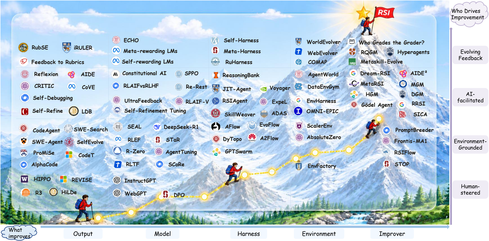
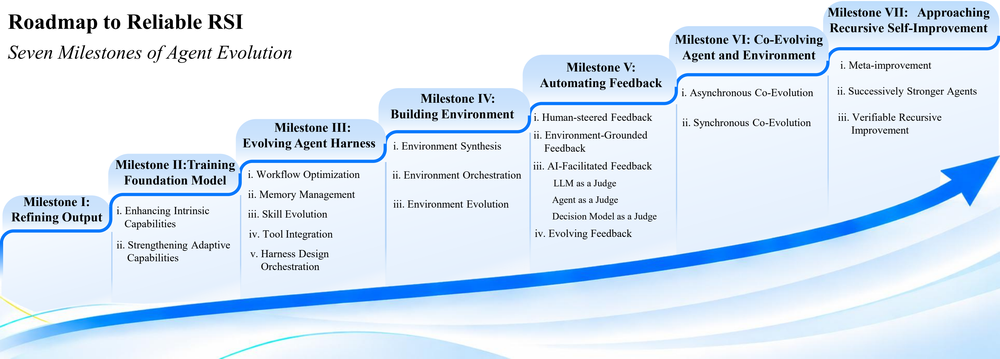
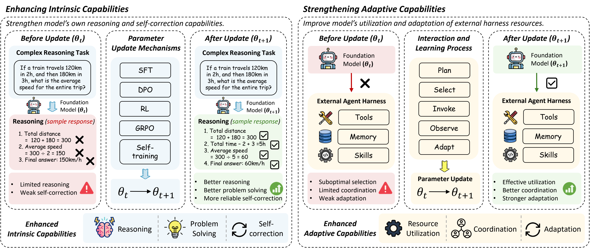
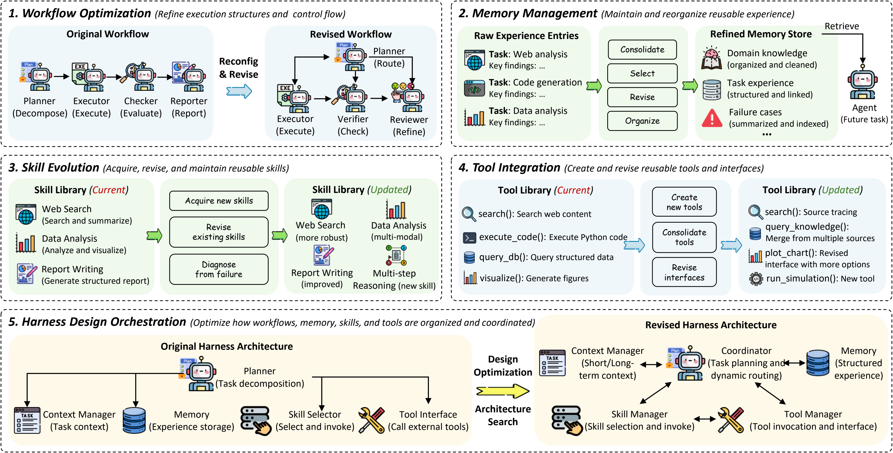
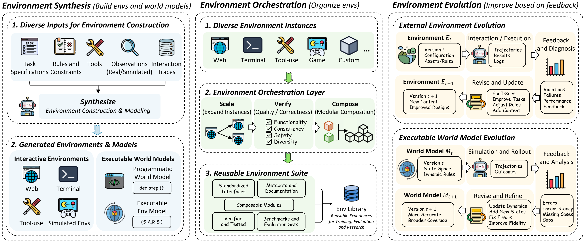
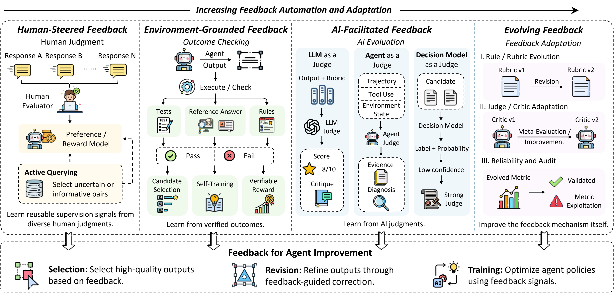
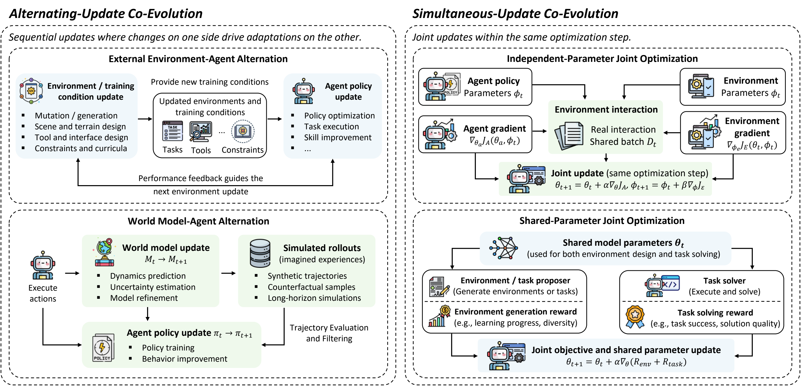
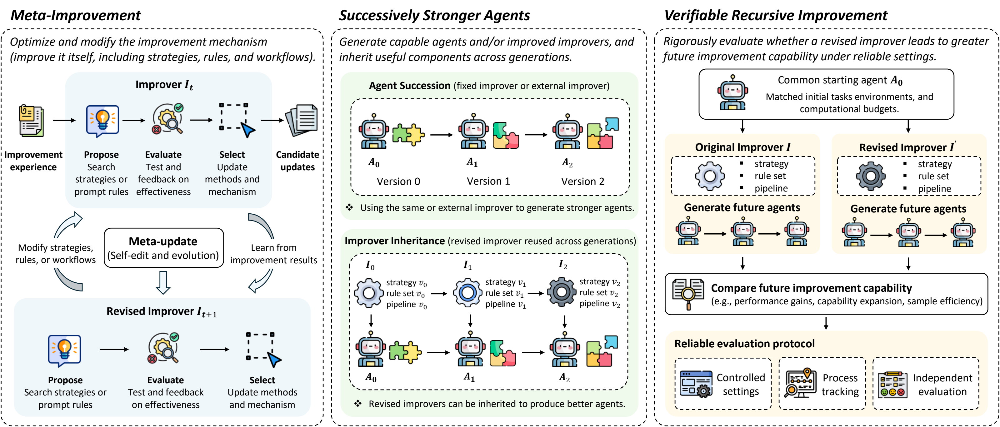
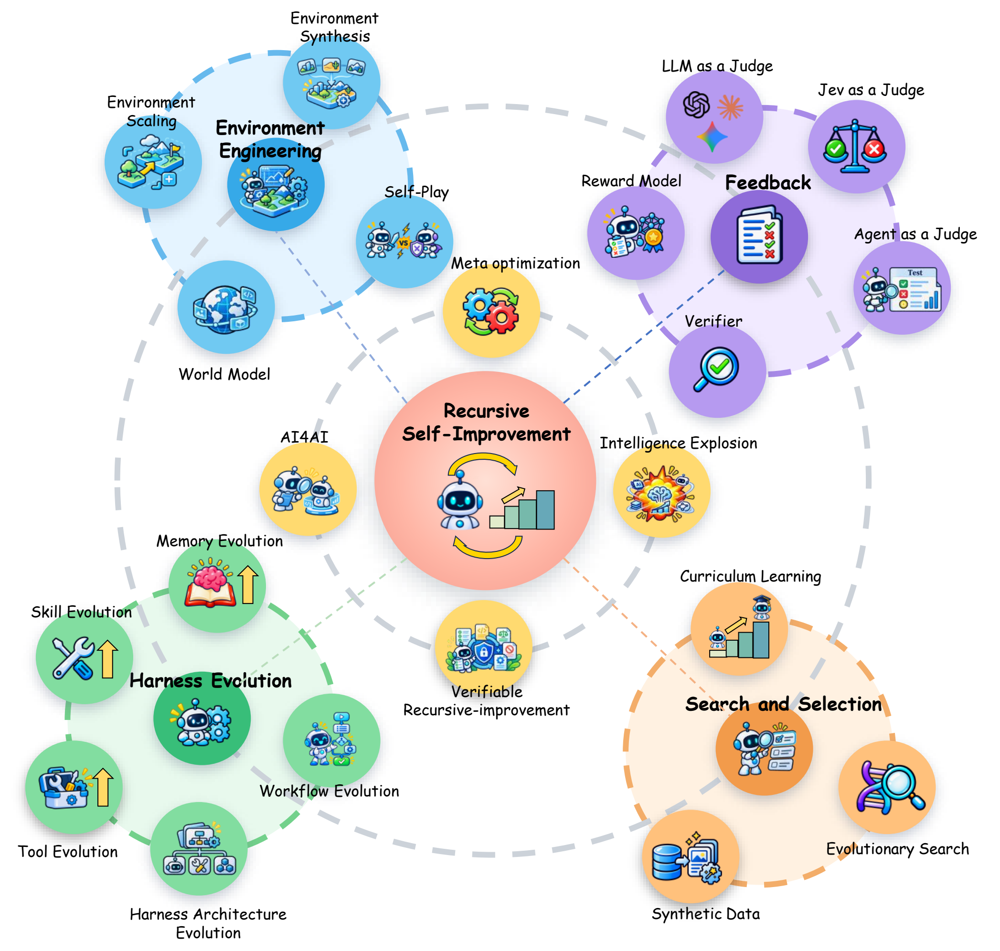

# What Improves, Who Drives It: A Roadmap Towards Reliable Recursive Self-Improvement

<div align="center">
  <a href="https://awesome.re"></a>
  <a href="http://makeapullrequest.com"></a>
  <a href="https://github.com/DEEP-JLU/Awesome-RSI-Papers"></a>
</div>

A curated collection of research papers, benchmarks, and open-source projects on **Recursive Self-Improvement**. This repository accompanies the survey *What Improves, Who Drives It: A Roadmap Towards Reliable Recursive Self-Improvement* and will be continuously updated.

Recursive Self-Improvement studies how execution experience and feedback support persistent improvements to foundation models, agent harnesses, environments, and the improver itself. Building on the complementary axes of **What Improves** and **Who Drives Improve**, the collection organizes existing research into **seven interrelated milestones** toward reliable RSI, emphasizing appropriate evolution targets, valid feedback, and verifiable future improvement capability.

🤗 **Contributions are welcome.** If you find a missing resource or a relevant new work, please open an issue or submit a pull request.

**📃 Please [cite our paper](#-citation)** if you find this survey or repository helpful.

---

## 🎉 News

- **[2026-11]** We release the initial resource collection for Recursive Self-Improvement.

## Overview

The survey analyzes agent improvement toward reliable RSI along **two complementary axes** (Fig. 1):

- **What Improves** characterizes the objects and scope of agent improvement, tracing how task-local output refinement extends to persistent changes in the agent, its environment, and the improver itself.
- **Who Drives Improve** characterizes the sources of feedback and the mechanisms that guide improvement, explaining how signals are obtained and interpreted to identify weaknesses, evaluate candidate changes, and support further improvement as feedback mechanisms evolve.

<div align="center">
  
  <p><em>Fig. 1. Two-Axis Taxonomy Towards Recursive Self-Improvement.</em></p>
</div>

Based on the **What Improves** and **Who Drives Improve** axes in Fig. 1, we organize existing research toward reliable RSI into **seven interrelated milestones**, as illustrated in Fig. 2.

<div align="center">
  
  <p><em>Fig. 2. Roadmap to Reliable RSI.</em></p>
</div>

- **Refining Output** improves task-local artifacts through critique, verification, and revision.
- **Training Foundation Model** internalizes execution experience into persistent model capabilities.
- **Evolving Agent Harness** improves workflows, tools, memory, skills, and their orchestration.
- **Building Environment** synthesizes, orchestrates, and evolves environments and their executable models.
- **Automating Feedback** connects human-steered, environment-grounded, AI-facilitated, and evolving feedback.
- **Co-Evolving Agent and Environment** couples persistent updates of agents and environments through asynchronous or synchronous co-evolution.
- **Approaching Recursive Self-Improvement** examines meta-improvement, successively stronger agents, and verifiable recursive improvement.

## Table of Contents

- [What Improves, Who Drives It: A Roadmap Towards Reliable Recursive Self-Improvement](#what-improves-who-drives-it-a-roadmap-towards-reliable-recursive-self-improvement)
  - [🎉 News](#-news)
  - [Overview](#overview)
  - [Table of Contents](#table-of-contents)
  - [📚 Related Survey Papers](#-related-survey-papers)
  - [📜 Research Papers](#-research-papers)
    - [Milestone I: Refining Output](#milestone-i-refining-output)
    - [Milestone II: Training Foundation Model](#milestone-ii-training-foundation-model)
      - [Enhancing Intrinsic Capabilities](#enhancing-intrinsic-capabilities)
      - [Strengthening Adaptive Capabilities](#strengthening-adaptive-capabilities)
    - [Milestone III: Evolving Agent Harness](#milestone-iii-evolving-agent-harness)
      - [Workflow Optimization](#workflow-optimization)
      - [Tool Integration](#tool-integration)
      - [Memory Management](#memory-management)
      - [Skill Evolution](#skill-evolution)
      - [Harness Design Orchestration](#harness-design-orchestration)
    - [Milestone IV: Building Environment](#milestone-iv-building-environment)
      - [Environment Synthesis](#environment-synthesis)
      - [Environment Orchestration](#environment-orchestration)
      - [Environment Evolution](#environment-evolution)
    - [Milestone V: Automating Feedback](#milestone-v-automating-feedback)
      - [Human-Steered Feedback](#human-steered-feedback)
      - [Environment-Grounded Feedback](#environment-grounded-feedback)
      - [AI-Facilitated Feedback](#ai-facilitated-feedback)
        - [LLM as a Judge](#llm-as-a-judge)
        - [Agent as a Judge](#agent-as-a-judge)
        - [Decision Model as a Judge](#decision-model-as-a-judge)
      - [Evolving Feedback](#evolving-feedback)
    - [Milestone VI: Co-Evolving Agent and Environment](#milestone-vi-co-evolving-agent-and-environment)
      - [Asynchronous Co-Evolution](#asynchronous-co-evolution)
      - [Synchronous Co-Evolution](#synchronous-co-evolution)
    - [Milestone VII: Approaching Recursive Self-Improvement](#milestone-vii-approaching-recursive-self-improvement)
      - [Meta-Improvement](#meta-improvement)
      - [Successively Stronger Agents](#successively-stronger-agents)
      - [Verifiable Recursive Improvement](#verifiable-recursive-improvement)
    - [Benchmarks and Evaluation](#benchmarks-and-evaluation)
      - [What Improves: Target Evaluation](#what-improves-target-evaluation)
      - [Who Drives Improve: Feedback Evaluation](#who-drives-improve-feedback-evaluation)
    - [Challenges and Future Directions](#challenges-and-future-directions)
      - [Trustworthy RSI](#trustworthy-rsi)
      - [Scientific Agent RSI](#scientific-agent-rsi)
      - [Multi-Agent RSI](#multi-agent-rsi)
      - [RSI Infrastructure](#rsi-infrastructure)
      - [Intelligence Explosion](#intelligence-explosion)
  - [🏆 Benchmarks, Datasets, and Environments](#-benchmarks-datasets-and-environments)
    - [What Improves: Target Evaluation](#what-improves-target-evaluation-1)
      - [Model](#model)
      - [Harness](#harness)
      - [Environment](#environment)
      - [Improver](#improver)
    - [Who Drives Improve: Feedback Evaluation](#who-drives-improve-feedback-evaluation-1)
  - [💻 Open-Source Libraries](#-open-source-libraries)
    - [Training Foundation Model](#training-foundation-model)
    - [Evolving Agent Harness](#evolving-agent-harness)
    - [Building Environment](#building-environment)
    - [Approaching Recursive Self-Improvement](#approaching-recursive-self-improvement)
  - [🚀 Applications](#-applications)
    - [Software Engineering](#software-engineering)
    - [Autonomous AI Research](#autonomous-ai-research)
    - [Scientific Discovery](#scientific-discovery)
    - [Web and Digital Agents](#web-and-digital-agents)
    - [Open-World and Embodied Agents](#open-world-and-embodied-agents)
  - [🍀 Citation](#-citation)
  - [Acknowledgments](#acknowledgments)

## 📚 Related Survey Papers

- (arXiv 2026) Trustworthy Recursive Self-Improvement in the Era of Large Models: Foundation, Risks, Evaluation and Open Challenges [[Paper]](https://arxiv.org/abs/2610.35193)
- (Preprint 2026) Diving into Reliable Self-Evolving Agents: A Survey [[Paper]](https://www.preprints.org/manuscript/202609.0913)
- (arXiv 2025) A Comprehensive Survey of Self-Evolving AI Agents: A New Paradigm Bridging Foundation Models and Lifelong Agentic Systems [[Paper]](https://arxiv.org/abs/2508.07407)
- (TMLR 2026) A Survey of Self-Evolving Agents: What, When, How, and Where to Evolve on the Path to Artificial Super Intelligence [[Paper]](https://openreview.net/forum?id=CTr3bovS5F)
- (arXiv 2026) Self-Improvements in Modern Agentic Systems: A Survey [[Paper]](https://arxiv.org/abs/2607.13104)
- (TechRxiv 2026) A systematic survey of self-evolving agents: From model-centric to environment-driven co-evolution [[Paper]](https://doi.org/10.36227/techrxiv.177203250.05832634/v2)
- (arXiv 2026) Recursive Self-Improvement in AI: From Bounded Self-Refinement to Autonomous Research Loops [[Paper]](https://arxiv.org/abs/2607.07663)
- (arXiv 2026) The Last AI Built by Humans: Toward Genuine Recursive Self-Improvement [[Paper]](https://arxiv.org/abs/2609.11873)
- (Openreview 2026) Towards AI That Improves Itself: A Survey of Recursive Self-Improvement [[Paper]](https://openreview.net/forum?id=I3fKQbRUGy)
- (TACL 2024) When Can LLMs Actually Correct Their Own Mistakes? A Critical Survey of Self-Correction of LLMs [[Paper]](https://aclanthology.org/2024.tacl-1.78/)
- (arXiv 2024) LLMs-as-Judges: A Comprehensive Survey on LLM-based Evaluation Methods [[Paper]](https://arxiv.org/abs/2412.05579v2)

## 📜 Research Papers

Research papers are organized by the seven milestones introduced in the [Overview](#overview).

### Milestone I: Refining Output

- (NeurIPS 2023) **Self-Refine** — Self-Refine: Iterative Refinement with Self-Feedback [[Paper]](https://proceedings.neurips.cc/paper_files/paper/2023/hash/91edff07232fb1b55a505a9e9f6c0ff3-Abstract-Conference.html)
- (ICLR 2024) **CRITIC** — CRITIC: Large Language Models Can Self-Correct with Tool-Interactive Critiquing [[Paper]](https://arxiv.org/abs/2305.11738)
- (ICLR 2024) **Self-Debugging** — Teaching Large Language Models to Self-Debug [[Paper]](https://arxiv.org/abs/2304.05128)
- (Findings of ACL 2024) **CoVe** — Chain-of-Verification Reduces Hallucination in Large Language Models [[Paper]](https://aclanthology.org/2024.findings-acl.212/)
- (NeurIPS 2023) **RCI** — Language Models can Solve Computer Tasks [[Paper]](https://proceedings.neurips.cc/paper_files/paper/2023/file/7cc1005ec73cfbaac9fa21192b622507-Paper-Conference.pdf)
- (arXiv 2023) **SelfEvolve** — SelfEvolve: A Code Evolution Framework via Large Language Models [[Paper]](https://arxiv.org/abs/2306.02907)
- (NeurIPS 2024) **SWE-agent** — SWE-agent: Agent-Computer Interfaces Enable Automated Software Engineering [[Paper]](https://proceedings.neurips.cc/paper_files/paper/2024/hash/5a7c947568c1b1328ccc5230172e1e7c-Abstract-Conference.html)
- (Findings of ACL 2024) **LDB** — Debug like a Human: A Large Language Model Debugger via Verifying Runtime Execution Step by Step [[Paper]](https://aclanthology.org/2024.findings-acl.49/)
- (arXiv 2026) **RubSE** — Rubrics as Visual-Repair Context for Self-Evolving UI-to-Code Generation [[Paper]](https://arxiv.org/abs/2608.24138)
- (ICLR 2024) **Large Language Models Cannot Self-Correct Reasoning Yet** [[Paper]](https://openreview.net/forum?id=IkmD3fKBPQ)
- (Findings of ACL 2024) **LLMs cannot find reasoning errors, but can correct them given the error location** [[Paper]](https://aclanthology.org/2024.findings-acl.826/)
- (TACL 2024) **When Can LLMs Actually Correct Their Own Mistakes? A Critical Survey of Self-Correction of LLMs** [[Paper]](https://aclanthology.org/2024.tacl-1.78/)

### Milestone II: Training Foundation Model

<div align="center">
  
  <p><em>Enhancing intrinsic capabilities and strengthening adaptive capabilities.</em></p>
</div>

#### Enhancing Intrinsic Capabilities

- (NeurIPS 2022) **STaR** — STaR: Bootstrapping Reasoning With Reasoning [[Paper]](https://proceedings.neurips.cc/paper_files/paper/2022/hash/639a9a172c044fbb64175b5fad42e9a5-Abstract-Conference.html)
- (arXiv 2023) **ReST** — Reinforced Self-Training (ReST) for Language Modeling [[Paper]](https://arxiv.org/abs/2308.08998)
- (ICML 2024) **SPIN** — Self-Play Fine-Tuning Converts Weak Language Models to Strong Language Models [[Paper]](https://proceedings.mlr.press/v235/chen24j.html)
- (COLM 2024) **Quiet-STaR** — Quiet-STaR: Language Models Can Teach Themselves to Think Before Speaking [[Paper]](https://openreview.net/forum?id=oRXPiSOGH9)
- (COLM 2024) **V-STaR** — V-STaR: Training Verifiers for Self-Taught Reasoners [[Paper]](https://openreview.net/forum?id=stmqBSW2dV)
- (NeurIPS 2024) **ReST-MCTS\*** — ReST-MCTS\*: LLM Self-Training via Process Reward Guided Tree Search [[Paper]](https://proceedings.neurips.cc/paper_files/paper/2024/hash/76ec4dc30e9faaf0e4b6093eaa377218-Abstract-Conference.html)
- (ICML 2025) **rStar-Math** — rStar-Math: Small LLMs Can Master Math Reasoning with Self-Evolved Deep Thinking [[Paper]](https://proceedings.mlr.press/v267/guan25f.html)
- (arXiv 2024) **DeepSeekMath** — DeepSeekMath: Pushing the Limits of Mathematical Reasoning in Open Language Models [[Paper]](https://arxiv.org/abs/2402.03300v3)
- (Nature 2025) **DeepSeek-R1** — DeepSeek-R1 incentivizes reasoning in LLMs through reinforcement learning [[Paper]](https://www.nature.com/articles/s41586-025-09422-z)
- (arXiv 2025) **Open-Reasoner-Zero** — Open-Reasoner-Zero: An Open Source Approach to Scaling Up Reinforcement Learning on the Base Model [[Paper]](https://arxiv.org/abs/2503.24290)
- (ICLR 2025) **SCoRe** — Training Language Models to Self-Correct via Reinforcement Learning [[Paper]](https://arxiv.org/abs/2409.12917)
- (NeurIPS 2025) **Absolute Zero** — Absolute Zero: Reinforced Self-play Reasoning with Zero Data [[Paper]](https://papers.nips.cc/paper_files/paper/2025/hash/9837dc00ff67d176373268ed48042d49-Abstract-Conference.html)
- (ICLR 2026) **R-Zero** — R-Zero: Self-Evolving Reasoning LLM from Zero Data [[Paper]](https://openreview.net/forum?id=96apU6YzSO)
- (TMLR 2024) **Beyond Human Data** — Beyond Human Data: Scaling Self-Training for Problem-Solving with Language Models [[Paper]](https://arxiv.org/abs/2312.06585)
- (JMLR 2024) **Scaling Instruction-Finetuned Language Models** [[Paper]](https://www.jmlr.org/papers/v25/23-0870.html)
- (ACL 2023) **Self-Instruct** — Self-Instruct: Aligning Language Models with Self-Generated Instructions [[Paper]](https://aclanthology.org/2023.acl-long.754/)
- (NeurIPS 2022) **InstructGPT** — Training language models to follow instructions with human feedback [[Paper]](https://proceedings.neurips.cc/paper_files/paper/2022/hash/b1efde53be364a73914f58805a001731-Abstract.html)
- (NeurIPS 2023) **DPO** — Direct Preference Optimization: Your Language Model is Secretly a Reward Model [[Paper]](https://proceedings.neurips.cc/paper_files/paper/2023/file/a85b405ed65c6477a4fe8302b5e06ce7-Paper-Conference.pdf)
- (ICML 2024) **Model Alignment as Prospect Theoretic Optimization** [[Paper]](https://proceedings.mlr.press/v235/ethayarajh24a.html)
- (EMNLP 2024) **ORPO** — ORPO: Monolithic Preference Optimization without Reference Model [[Paper]](https://aclanthology.org/2024.emnlp-main.626/)
- (NeurIPS 2024) **SimPO** — SimPO: Simple Preference Optimization with a Reference-Free Reward [[Paper]](https://proceedings.neurips.cc/paper_files/paper/2024/hash/e099c1c9699814af0be873a175361713-Abstract.html)

#### Strengthening Adaptive Capabilities

- (NeurIPS 2023) **Toolformer** — Toolformer: Language Models Can Teach Themselves to Use Tools [[Paper]](https://proceedings.neurips.cc/paper/2023/hash/d842425e4bf79ba039352da0f658a906-Abstract-Conference.html)
- (ICLR 2024) **ToolLLM** — ToolLLM: Facilitating Large Language Models to Master 16000+ Real-world APIs [[Paper]](https://openreview.net/forum?id=dHng2O0Jjr)
- (arXiv 2023) **FireAct** — FireAct: Toward Language Agent Fine-tuning [[Paper]](https://arxiv.org/abs/2310.05915)
- (Findings of ACL 2024) **AgentTuning** — AgentTuning: Enabling Generalized Agent Abilities for LLMs [[Paper]](https://aclanthology.org/2024.findings-acl.181/)
- (Findings of ACL 2026) **ToolCPT** — ToolCPT: Improving Tool Utilization in LLM Agents via Continuous Pre-training [[Paper]](https://aclanthology.org/2026.findings-acl.776/)
- (ACL 2026) **Memory-R1** — Memory-R1: Enhancing Large Language Model Agents to Manage and Utilize Memories via Reinforcement Learning [[Paper]](https://aclanthology.org/2026.acl-long.583/)
- (ACL 2026) **Agentic Memory** — Agentic Memory: Learning Unified Long-Term and Short-Term Memory Management for Large Language Model Agents [[Paper]](https://aclanthology.org/2026.acl-long.981/)
- (arXiv 2026) **SkillRL** — SkillRL: Evolving Agents via Recursive Skill-Augmented Reinforcement Learning [[Paper]](https://arxiv.org/abs/2602.08234)
- (ACL 2026) **SAGE** — Reinforcement Learning for Self-Improving Agent with Skill Library [[Paper]](https://aclanthology.org/2026.acl-long.69/)
- (arXiv 2026) **Skill1** — Skill1: Unified Evolution of Skill-Augmented Agents via Reinforcement Learning [[Paper]](https://arxiv.org/abs/2605.06130)
- (arXiv 2026) **SkillGraph** — SkillGraph: Skill-Augmented Reinforcement Learning for Agents via Evolving Skill Graphs [[Paper]](https://arxiv.org/abs/2605.12039)
- (arXiv 2026) **SkillGym** — SkillGym: Internalizing Human Skills into LLMs for Real-World Problem Solving [[Paper]](https://arxiv.org/abs/2609.27717)
- (COLM 2025) **Search-R1** — Search-R1: Training LLMs to Reason and Leverage Search Engines with Reinforcement Learning [[Paper]](https://openreview.net/forum?id=Rwhi91ideu)
- (arXiv 2025) **ReTool** — ReTool: Reinforcement Learning for Strategic Tool Use in LLMs [[Paper]](https://arxiv.org/abs/2504.11536)
- (ICML 2026) **AutoTool** — AutoTool: Dynamic Tool Selection and Integration for Agentic Reasoning [[Paper]](https://proceedings.mlr.press/v306/zou26p.html)
- (ICML 2026) **ToolOrchestra** — ToolOrchestra: Elevating Intelligence via Efficient Model and Tool Orchestration [[Paper]](https://proceedings.mlr.press/v306/su26d.html)
- (arXiv 2025) **Agent Lightning** — Agent Lightning: Train ANY AI Agents with Reinforcement Learning [[Paper]](https://arxiv.org/abs/2508.03680)
- (arXiv 2026) **Self-HPO** — Self-Evolving Coding Agents via Harness-Policy Optimization [[Paper]](https://arxiv.org/abs/2610.22791)
- (arXiv 2026) **COEVO** — COEVO: Co-Evolving Context and Parameters for Recursive Self-Improvement [[Paper]](https://arxiv.org/abs/2609.33398)
- (ICLR 2026) **CodeGym** — Generalizable End-to-End Tool-Use RL with Synthetic CodeGym [[Paper]](https://proceedings.iclr.cc/paper_files/paper/2026/hash/1e4322fddd833f83c855660ac65e428d-Abstract-Conference.html)
- (arXiv 2026) **OpenAgent** — Can Agents Generalize to the Open World? Unveiling the Fragility of Static Training in Tool Use [[Paper]](https://arxiv.org/abs/2607.01084)
- (arXiv 2026) **RSIPO** — RSIPO: Recursive Self-Improving Policy Optimization for Agentic Reinforcement Learning via Skill-Policy Co-Evolution [[Paper]](https://arxiv.org/abs/2610.15772)
- (arXiv 2026) **SAAS** — SAAS: Self-Aware Reinforcement Learning for Over-Search Mitigation in Agentic Search [[Paper]](https://arxiv.org/abs/2605.29796)
- (arXiv 2026) **BAPO** — BAPO: Boundary-Aware Policy Optimization for Reliable Agentic Search [[Paper]](https://arxiv.org/abs/2601.11037)

### Milestone III: Evolving Agent Harness

<div align="center">
  
  <p><em>Workflow optimization, tool integration, memory management, skill evolution, and harness design orchestration.</em></p>
</div>

#### Workflow Optimization

- (ICML 2024) **GPTSwarm** — GPTSwarm: Language Agents as Optimizable Graphs [[Paper]](https://proceedings.mlr.press/v235/zhuge24a.html)
- (arXiv 2024) **AutoFlow** — AutoFlow: Automated Workflow Generation for Large Language Model Agents [[Paper]](https://arxiv.org/abs/2407.12821)
- (ICLR 2025) **AFlow** — AFlow: Automating Agentic Workflow Generation [[Paper]](https://arxiv.org/abs/2410.10762)
- (ICLR 2026) **MASS** — Multi-Agent Design: Optimizing Agents with Better Prompts and Topologies [[Paper]](https://arxiv.org/abs/2502.02533)
- (arXiv 2024) **AgentPrune** — Cut the Crap: An Economical Communication Pipeline for LLM-based Multi-Agent Systems [[Paper]](https://arxiv.org/abs/2410.02506)
- (arXiv 2025) **EvoFlow** — EvoFlow: Evolving Diverse Agentic Workflows On The Fly [[Paper]](https://arxiv.org/abs/2502.07373)
- (Proceedings of the AAAI Conference on Artificial Intelligence 2026) **A2Flow** — A²Flow: Automating Agentic Workflow Generation via Self-Adaptive Abstraction Operators [[Paper]](https://ojs.aaai.org/index.php/AAAI/article/view/40240)
- (ICLR 2025) **ADAS** — Automated Design of Agentic Systems [[Paper]](https://openreview.net/pdf?id=t9U3LW7JVX)
- (arXiv 2026) **CollabFlow** — CollabFlow: Recursive Self-Improvement of Agent Collaboration [[Paper]](https://arxiv.org/abs/2609.38662)

#### Tool Integration

- (ICLR 2024) **LATM** — Large Language Models as Tool Makers [[Paper]](https://openreview.net/forum?id=qV83K9d5WB)
- (ICLR 2024) **CRAFT** — CRAFT: Customizing LLMs by Creating and Retrieving from Specialized Toolsets [[Paper]](https://openreview.net/forum?id=G0vdDSt9XM)
- (ICML 2024) **TroVE** — TroVE: Inducing Verifiable and Efficient Toolboxes for Solving Programmatic Tasks [[Paper]](https://proceedings.mlr.press/v235/wang24az.html)
- (ICML 2024) **ReGAL** — ReGAL: Refactoring Programs to Discover Generalizable Abstractions [[Paper]](https://proceedings.mlr.press/v235/stengel-eskin24a.html)
- (arXiv 2025) **ToolLibGen** — ToolLibGen: Scalable Automatic Tool Creation and Aggregation for LLM Reasoning [[Paper]](https://arxiv.org/abs/2510.07768)
- (ACL 2026) **GATE** — GATE: Graph-based Adaptive Tool Evolution Across Diverse Tasks [[Paper]](https://aclanthology.org/2026.acl-long.87/)
- (Findings of ACL 2026) **ContDa** — Beyond Static Toolsets: Self-Evolving LLM Tool Agents via Continual Documentation Adaptation [[Paper]](https://aclanthology.org/2026.findings-acl.1082/)
- (Findings of EMNLP 2023) **CREATOR** — CREATOR: Tool Creation for Disentangling Abstract and Concrete Reasoning of Large Language Models [[Paper]](https://aclanthology.org/2023.findings-emnlp.462/)

#### Memory Management

- (NeurIPS 2023) **Reflexion** — Reflexion: Language Agents with Verbal Reinforcement Learning [[Paper]](https://proceedings.neurips.cc/paper_files/paper/2023/hash/1b44b878bb782e6954cd888628510e90-Abstract-Conference.html)
- (Proceedings of the AAAI Conference on Artificial Intelligence 2024) **ExpeL** — ExpeL: LLM Agents Are Experiential Learners [[Paper]](https://ojs.aaai.org/index.php/AAAI/article/view/29936)
- (ICLR 2026) **ReasoningBank** — ReasoningBank: Scaling Agent Self-Evolving with Reasoning Memory [[Paper]](https://arxiv.org/abs/2509.25140)
- (EACL 2026) **DC** — Dynamic Cheatsheet: Test-Time Learning with Adaptive Memory [[Paper]](https://aclanthology.org/2026.eacl-long.333/)
- (NeurIPS 2025) **A-MEM** — A-MEM: Agentic Memory for LLM Agents [[Paper]](https://proceedings.neurips.cc/paper_files/paper/2025/hash/19909c36f51abc4856b4560aff3d36d6-Abstract-Conference.html)
- (Findings of ACL 2026) **ReMe** — Remember Me, Refine Me: A Dynamic Procedural Memory Framework for Experience-Driven Agent Evolution [[Paper]](https://aclanthology.org/2026.findings-acl.829/)
- (ICML 2026) **Darwinian Memory** — Darwinian Memory: A Training-Free Self-Regulating Memory System for GUI Agent Evolution [[Paper]](https://proceedings.mlr.press/v306/mi26b.html)
- (arXiv 2026) **MemRL** — MemRL: Self-Evolving Agents via Runtime Reinforcement Learning on Episodic Memory [[Paper]](https://arxiv.org/abs/2601.03192)
- (ICML 2026) **MemEvolve** — MemEvolve: Meta-Evolution of Agent Memory Systems [[Paper]](https://proceedings.mlr.press/v306/zhang26fa.html)
- (arXiv 2026) **EvolveMem** — EvolveMem: Self-Evolving Memory Architecture via AutoResearch for LLM Agents [[Paper]](https://arxiv.org/abs/2605.13941)
- (arXiv 2026) **MemSkill** — MemSkill: Learning and Evolving Memory Skills for Self-Evolving Agents [[Paper]](https://arxiv.org/abs/2602.02474)
- (arXiv 2026) **MetaMem** — MetaMem: Evolving Meta-Memory for Knowledge Utilization through Self-Reflective Symbolic Optimization [[Paper]](https://arxiv.org/abs/2602.11182)
- (ICLR 2026) **ACE** — Agentic Context Engineering: Evolving Contexts for Self-Improving Language Models [[Paper]](https://arxiv.org/abs/2510.04618)
- (arXiv 2026) **MemSyco-Bench** — MemSyco-Bench: Benchmarking Sycophancy in Agent Memory [[Paper]](https://arxiv.org/abs/2607.01071)
- (arXiv 2026) **RSIAgent** — RSIAgent: Autonomous Exploration for Recursive Self-improvement in New Environments [[Paper]](https://arxiv.org/abs/2609.15364)
- (arXiv 2026) **MemAdapter** — Memadapter: Counterfactual Adaptation Against Memory-induced Sycophancy [[Paper]](https://arxiv.org/abs/2610.05162)

#### Skill Evolution

- (TMLR 2024) **Voyager** — Voyager: An Open-Ended Embodied Agent with Large Language Models [[Paper]](https://openreview.net/pdf?id=ehfRiF0R3a)
- (COLM 2025) **ASI** — Inducing Programmatic Skills for Agentic Tasks [[Paper]](https://openreview.net/forum?id=lsAY6fWsog)
- (arXiv 2025) **SkillWeaver** — SkillWeaver: Web Agents can Self-Improve by Discovering and Honing Skills [[Paper]](https://arxiv.org/abs/2504.07079)
- (arXiv 2026) **AutoSkill** — AutoSkill: Experience-Driven Lifelong Learning via Skill Self-Evolution [[Paper]](https://arxiv.org/abs/2603.01145)
- (arXiv 2026) **Trace2Skill** — Trace2Skill: Distill Trajectory-Local Lessons into Transferable Agent Skills [[Paper]](https://arxiv.org/abs/2603.25158)
- (arXiv 2026) **SkillX** — SkillX: Automatically Constructing Skill Knowledge Bases for Agents [[Paper]](https://arxiv.org/abs/2604.04804)
- (arXiv 2026) **SkillClaw** — SkillClaw: Let Skills Evolve Collectively with Agentic Evolver [[Paper]](https://arxiv.org/abs/2604.08377)
- (arXiv 2026) **PSN** — Evolving Programmatic Skill Networks [[Paper]](https://arxiv.org/abs/2601.03509)
- (SIGIR 2026) **SkillForge** — SkillForge: Forging Domain-Specific, Self-Evolving Agent Skills in Cloud Technical Support [[Paper]](https://arxiv.org/abs/2604.08618)
- (arXiv 2026) **ContractSkill** — ContractSkill: Repairable Contract-Based Skills for Multimodal Web Agents [[Paper]](https://arxiv.org/abs/2603.20340)
- (COLM 2026) **CoEvoSkills** — CoEvoSkills: Self-Evolving Agent Skills via Co-Evolutionary Verification [[Paper]](https://arxiv.org/abs/2604.01687)
- (arXiv 2026) **Skill-R1** — Skill-R1: Agent Skill Evolution via Reinforcement Learning [[Paper]](https://arxiv.org/abs/2605.09359)
- (arXiv 2026) **EviSkill** — EVISKILL: Grounding Skill Evolution in Replayable Evidence [[Paper]](https://arxiv.org/abs/2610.05030)
- (arXiv 2026) **SkillOpt** — SkillOpt: Executive Strategy for Self-Evolving Agent Skills [[Paper]](https://arxiv.org/abs/2605.23904)
- (arXiv 2026) **GraphSkillAA** — GraphSkillAA: Attribution-Guided Skill-Graph Updating with Targeted Validation and Rollback [[Paper]](https://arxiv.org/abs/2609.20455)
- (arXiv 2026) **WikiSkill** — WikiSkill: Compiling Agent Experience into Persistent Knowledge for Skill Evolution [[Paper]](https://arxiv.org/abs/2608.27454)
- (EMNLP 2026) **Skill.state** — SKILL.state: Scalable Long-Horizon Agent Skills [[Paper]](https://aclanthology.org/2026.emnlp-industry.264/)

#### Harness Design Orchestration

- (ICLR 2025) **AgentSquare** — AgentSquare: Automatic LLM Agent Search in Modular Design Space [[Paper]](https://arxiv.org/abs/2410.06153)
- (arXiv 2026) **Meta-Harness** — Meta-Harness: End-to-End Optimization of Model Harnesses [[Paper]](https://arxiv.org/abs/2603.28052)
- (arXiv 2026) **Self-Harness** — Self-Harness: Harnesses That Improve Themselves [[Paper]](https://arxiv.org/abs/2606.09498)
- (arXiv 2026) **Continual Harness** — Continual Harness: Online Adaptation for Self-Improving Foundation Agents [[Paper]](https://arxiv.org/abs/2605.09998)
- (arXiv 2026) **Adaptive Auto-Harness** — Adaptive Auto-Harness: Sustained Self-Improvement for Agentic System Deployment on Open-Ended Task Streams [[Paper]](https://arxiv.org/abs/2606.01770)
- (arXiv 2026) **JIT-Agent** — JIT-Agent: Scaling Harness Intelligence via Just-in-Time Harness Evolution [[Paper]](https://arxiv.org/abs/2608.25593)
- (arXiv 2026) **Harness Benefit** — Harness Updating Is Not Harness Benefit: Disentangling Evolution Capabilities in Self-Evolving LLM Agents [[Paper]](https://arxiv.org/abs/2605.30621)
- (arXiv 2026) **HarnessEvolve** — HarnessEvolve: Learning from Reference Trajectories for Reliable Agent Self-Evolution [[Paper]](https://arxiv.org/abs/2609.00829)
- (arXiv 2026) **EvoHarness-RL** — EvoHarness-RL: Learning Runtime Harness Coordination for Self-Evolving Agents [[Paper]](https://arxiv.org/abs/2608.05446)
- (arXiv 2026) **HarnessDev** — HarnessDev: Can LLMs Create and Evolve Their Own Agent Harness? [[Paper]](https://arxiv.org/abs/2609.01437)
- (arXiv 2026) **Rethinking** — Rethinking the Evaluation of Harness Evolution for Agents [[Paper]](https://arxiv.org/abs/2607.12227)
- (arXiv 2026) **HarnessCompass** — HarnessCompass: Guiding Automatic Harness Evolution toward Generalizable and Effective Agent Harnesses [[Paper]](https://arxiv.org/abs/2608.01918)

### Milestone IV: Building Environment

<div align="center">
  
  <p><em>Environment synthesis, orchestration, and evolution.</em></p>
</div>

#### Environment Synthesis

- (COLM 2024) **EnvGen** — EnvGen: Generating and Adapting Environments via LLMs for Training Embodied Agents [[Paper]](https://arxiv.org/abs/2403.12014)
- (NeurIPS 2025) **WALL-E** — WALL-E: World Alignment by NeuroSymbolic Learning improves World Model-based LLM Agents [[Paper]](https://proceedings.neurips.cc/paper_files/paper/2025/hash/5e772a13ccba5255331240dcd99aa38b-Abstract-Conference.html)
- (arXiv 2026) **Agent-World** — Agent-World: Scaling Real-World Environment Synthesis for Evolving General Agent Intelligence [[Paper]](https://arxiv.org/abs/2604.18292)
- (arXiv 2026) **Envs-FORGE** — Envs-FORGE: Frontier-Optimized Reward-Grounded Environment Synthesis for Agent RL [[Paper]](https://arxiv.org/abs/2608.14312)
- (KDD 2025) **AgentGen** — AgentGen: Enhancing Planning Abilities for Large Language Model based Agent via Environment and Task Generation [[Paper]](https://arxiv.org/abs/2408.00764)
- (EMNLP 2026) **AutoForge** — AutoForge: Automated Environment Synthesis for Agentic Reinforcement Learning [[Paper]](https://aclanthology.org/2026.emnlp-main.837/)
- (CoG 2024) **PCGRL+** — PCGRL+: Scaling, Control and Generalization in Reinforcement Learning Level Generators [[Paper]](https://ieeexplore.ieee.org/document/10645598/)
- (NeurIPS 2024) **WorldCoder** — WorldCoder, a Model-Based LLM Agent: Building World Models by Writing Code and Interacting with the Environment [[Paper]](https://proceedings.neurips.cc/paper_files/paper/2024/hash/820c61a0cd419163ccbd2c33b268816e-Abstract-Conference.html)
- (NeurIPS 2024) **GIF-MCTS** — Generating Code World Models with Large Language Models Guided by Monte Carlo Tree Search [[Paper]](https://proceedings.neurips.cc/paper_files/paper/2024/hash/6f479ea488e0908ac8b1b37b27fd134c-Abstract-Conference.html)
- (NeurIPS 2025) **PoE-World** — PoE-World: Compositional World Modeling with Products of Programmatic Experts [[Paper]](https://proceedings.neurips.cc/paper_files/paper/2025/hash/262dd62fd1bbb30d6a6b4d578f5e65ff-Abstract-Conference.html)
- (arXiv 2026) **Code as Worlds** — Code as Worlds: Agentic Discovery of Executable World Representations for Physical Reasoning [[Paper]](https://arxiv.org/abs/2608.27549)
- (Preprint 2026) **Agentic PCG** — Agentic PCG: Procedural Content Generation via Tool-using LLMs [[Paper]](https://ssrn.com/abstract=6499021)
- (arXiv 2026) **SimWorld Studio** — SimWorld Studio: Automatic Environment Generation with Evolving Coding Agent for Embodied Agent Learning [[Paper]](https://arxiv.org/abs/2605.09423)
- (ICML 2026) **Agent World Model** — Agent World Model: Infinity Synthetic Environments for Agentic Reinforcement Learning [[Paper]](https://proceedings.mlr.press/v306/wang26jh.html)

#### Environment Orchestration

- (arXiv 2025) **AutoEnv** — AutoEnv: Automated Environments for Measuring Cross-Environment Agent Learning [[Paper]](https://arxiv.org/abs/2511.19304)
- (ACL 2026) **InfiniteWeb** — InfiniteWeb: Scalable Web Environment Synthesis for GUI Agent Training [[Paper]](https://aclanthology.org/2026.acl-long.1313/)
- (Findings of ACL 2026) **EnvScaler** — EnvScaler: Scaling Tool-Interactive Environments for LLM Agent via Programmatic Synthesis [[Paper]](https://aclanthology.org/2026.findings-acl.407/)
- (arXiv 2026) **SWE-Universe** — SWE-Universe: Scale Real-World Verifiable Environments to Millions [[Paper]](https://arxiv.org/abs/2602.02361)
- (arXiv 2026) **EnvFactory** — EnvFactory: Scaling Tool-Use Agents via Executable Environments Synthesis and Robust RL [[Paper]](https://arxiv.org/abs/2605.18703)
- (arXiv 2026) **LOGIGEN** — LOGIGEN: Logic-Driven Generation of Verifiable Agentic Tasks [[Paper]](https://arxiv.org/abs/2603.00540)
- (arXiv 2026) **Kepler** — Kepler: Auditable World Models for ARC-AGI-3 [[Paper]](https://arxiv.org/abs/2610.00834)
- (Findings of ACL 2026) **AgentScaler** — Towards General Agentic Intelligence via Environment Scaling [[Paper]](https://aclanthology.org/2026.findings-acl.872/)
- (ICML 2026) **ScaleEnv** — ScaleEnv: Scaling Environment Synthesis from Scratch for Generalist Interactive Tool-Use Agent Training [[Paper]](https://proceedings.mlr.press/v306/tu26a.html)
- (ICML 2026) **AutoWebWorld** — AutoWebWorld: Synthesizing Infinite Verifiable Web Environments via Finite State Machines [[Paper]](https://proceedings.mlr.press/v306/wu26ar.html)
- (ICML 2026) **RLVE** — RLVE: Scaling Up Reinforcement Learning for Language Models with Adaptive Verifiable Environments [[Paper]](https://proceedings.mlr.press/v306/zeng26j.html)
- (ICLR 2025) **WebRL** — WebRL: Training LLM Web Agents via Self-Evolving Online Curriculum Reinforcement Learning [[Paper]](https://proceedings.iclr.cc/paper_files/paper/2025/hash/c66e1fcc9691aae706250638f36f681b-Abstract-Conference.html)
- (Findings of ACL 2026) **SCALER** — SCALER: Synthetic Scalable Adaptive Learning Environment for Reasoning [[Paper]](https://aclanthology.org/2026.findings-acl.1596/)
- (arXiv 2025) **CuES** — CuES: A Curiosity-driven and Environment-grounded Synthesis Framework for Agentic RL [[Paper]](https://arxiv.org/abs/2512.01311)
- (arXiv 2026) **RACES** — Verifiable Environments Are LEGO Bricks: Recursive Composition for Reasoning Generalization [[Paper]](https://arxiv.org/abs/2606.12373)
- (ICLR 2026) **DreamGym** — Scaling Agent Learning via Experience Synthesis [[Paper]](https://openreview.net/pdf?id=cf7qpBwttr)
- (arXiv 2026) **Endless Terminals** — Endless Terminals: Scaling RL Environments for Terminal Agents [[Paper]](https://arxiv.org/abs/2601.16443)
- (arXiv 2026) **SETA** — SETA: Scaling Environments for Terminal Agents [[Paper]](https://arxiv.org/abs/2607.10891)
- (COLM 2026) **Self-Evolving Curriculum for LLM Reasoning** [[Paper]](https://arxiv.org/abs/2505.14970)
- (arXiv 2026) **Training Needs Trustworthy Worlds** — Training Needs Trustworthy Worlds: Verified Synthetic Web Environments for Agent Learning [[Paper]](https://arxiv.org/abs/2608.21898)
- (arXiv 2026) **Automatic Generation of High-Performance RL Environments** [[Paper]](https://arxiv.org/abs/2603.12145)

#### Environment Evolution

- (arXiv 2026) **RSIGame** — RSIGame: Autonomous Agentic Game Development with Recursive Self-improvement [[Paper]](https://arxiv.org/abs/2609.39045)
- (arXiv 2026) **Terminal Env Evolution** — Environment Evolution for Terminal Agents [[Paper]](https://arxiv.org/abs/2609.04128)
- (Findings of EMNLP 2026) **Play2Code** — GUI Agents for Continual Game Generation [[Paper]](https://aclanthology.org/2026.findings-emnlp.1100/)
- (arXiv 2026) **ProEvolve** — The World Won't Stay Still: Programmable Evolution for Agent Benchmarks [[Paper]](https://arxiv.org/abs/2603.05910)
- (arXiv 2026) **Twin** — Twin: Playing an Unknown Game with a Test-Time Digital Twin [[Paper]](https://arxiv.org/abs/2608.14490)
- (arXiv 2026) **Memento 3** — Memento 3: Model-Based Recursive Self-Improvement through Reflective Rulebooks [[Paper]](https://arxiv.org/abs/2610.11794)
- (arXiv 2026) **D-World** — D-World: An Explicit World-Language-Action Model with Recursive Self-Improvement under Dual Control [[Paper]](https://arxiv.org/abs/2610.17114)
- (arXiv 2026) **OPINE-World** — OPINE-World: Programmatic World Modeling with Ontology-error-Prioritized Interactive Exploration for ARC-AGI-3 [[Paper]](https://arxiv.org/abs/2607.01531)
- (arXiv 2026) **EvoBelief** — EvoBelief: Falsifiable World Models for Self-Improving LLM Agents [[Paper]](https://arxiv.org/abs/2610.12789)
- (arXiv 2026) **Env-Rethink** — Breaking the Environment Wall: A Unified Framework for Preparing and Evolving Agent-Native Environments [[Paper]](https://arxiv.org/abs/2609.29773)
- (Findings of EMNLP 2026) **WorldEvolver** — Self-Evolving World Models for LLM Agent Planning [[Paper]](https://aclanthology.org/2026.findings-emnlp.2221/)
- (arXiv 2026) **ProPlay** — ProPlay: Procedural World Models for Self-Evolving LLM Agents [[Paper]](https://arxiv.org/abs/2606.12780)
- (arXiv 2025) **DataEnvGym** — DataEnvGym: Data Generation Agents in Teacher Environments with Student Feedback [[Paper]](https://arxiv.org/abs/2410.06215)
- (arXiv 2026) **WorkRover** — WorkRover: Scaling Long-Horizon Cowork Agent Training Via Recursive Environment Evolution [[Paper]](https://arxiv.org/abs/2610.18067)
- (arXiv 2026) **EnvHarness** — EnvHarness: Awakening Static Worlds for Agent Learning [[Paper]](https://arxiv.org/abs/2608.19880)

### Milestone V: Automating Feedback

<div align="center">
  
  <p><em>Human-steered, environment-grounded, AI-facilitated, and evolving feedback.</em></p>
</div>

#### Human-Steered Feedback

- (NeurIPS 2017) **Human Preferences** — Deep Reinforcement Learning from Human Preferences [[Paper]](https://proceedings.neurips.cc/paper/2017/hash/d5e2c0adad503c91f91df240d0cd4e49-Abstract.html)
- (NeurIPS 2020) **Feedback Summarization** — Learning to summarize from human feedback [[Paper]](https://proceedings.neurips.cc/paper_files/paper/2020/file/1f89885d556929e98d3ef9b86448f951-Paper.pdf)
- (NeurIPS 2022) **InstructGPT** — Training language models to follow instructions with human feedback [[Paper]](https://proceedings.neurips.cc/paper_files/paper/2022/hash/b1efde53be364a73914f58805a001731-Abstract.html)
- (arXiv 2021) **WebGPT** — WebGPT: Browser-assisted question-answering with human feedback [[Paper]](https://arxiv.org/abs/2112.09332v3)
- (arXiv 2022) **Helpful & Harmless** — Training a Helpful and Harmless Assistant with Reinforcement Learning from Human Feedback [[Paper]](https://arxiv.org/abs/2204.05862v1)
- (ICML 2021) **PEBBLE** — PEBBLE: Feedback-Efficient Interactive Reinforcement Learning via Relabeling Experience and Unsupervised Pre-training [[Paper]](https://proceedings.mlr.press/v139/lee21i.html)
- (ICLR 2022) **SURF** — SURF: Semi-supervised Reward Learning with Data Augmentation for Feedback-efficient Preference-based Reinforcement Learning [[Paper]](https://arxiv.org/abs/2203.10050v1)
- (arXiv 2024) **Active Preferences** — Active Preference Learning for Large Language Models [[Paper]](https://arxiv.org/abs/2402.08114v2)
- (ICML 2025) **Active Reward** — Active Reward Modeling: Adaptive Preference Labeling for Large Language Model Alignment [[Paper]](https://proceedings.mlr.press/v267/shen25c.html)
- (ICML 2025) **PILAF** — PILAF: Optimal Human Preference Sampling for Reward Modeling [[Paper]](https://proceedings.mlr.press/v267/feng25g.html)
- (ICLR 2024) **Let's Verify Step by Step** [[Paper]](https://proceedings.iclr.cc/paper_files/paper/2024/hash/aca97732e30bcf1303bc22ac3924fd16-Abstract-Conference.html)
- (NeurIPS 2023) **DPO** — Direct Preference Optimization: Your Language Model is Secretly a Reward Model [[Paper]](https://proceedings.neurips.cc/paper_files/paper/2023/file/a85b405ed65c6477a4fe8302b5e06ce7-Paper-Conference.pdf)

#### Environment-Grounded Feedback

- (arXiv 2022) **AlphaCode** — Competition-Level Code Generation with AlphaCode [[Paper]](https://arxiv.org/abs/2203.07814v1)
- (ICLR 2023) **CodeT** — CodeT: Code Generation with Generated Tests [[Paper]](https://arxiv.org/abs/2207.10397v2)
- (arXiv 2024) **Tulu 3** — Tulu 3: Pushing Frontiers in Open Language Model Post-Training [[Paper]](https://arxiv.org/abs/2411.15124v5)
- (TMLR 2023) **RLTF** — RLTF: Reinforcement Learning from Unit Test Feedback [[Paper]](https://openreview.net/forum?id=hjYmsV6nXZ)
- (ICML 2025) **RLEF** — RLEF: Grounding Code LLMs in Execution Feedback with Reinforcement Learning [[Paper]](https://proceedings.mlr.press/v267/gehring25a.html)
- (ICML 2025) **SWE-Gym** — Training Software Engineering Agents and Verifiers with SWE-Gym [[Paper]](https://proceedings.mlr.press/v267/pan25g.html)
- (NeurIPS 2022) **CodeRL** — CodeRL: Mastering Code Generation through Pretrained Models and Deep Reinforcement Learning [[Paper]](https://proceedings.neurips.cc/paper_files/paper/2022/file/8636419dea1aa9fbd25fc4248e702da4-Paper-Conference.pdf)
- (ICLR 2025) **DeepSeek-Prover-V1.5** — DeepSeek-Prover-V1.5: Harnessing Proof Assistant Feedback for Reinforcement Learning and Monte-Carlo Tree Search [[Paper]](https://proceedings.iclr.cc/paper_files/paper/2025/file/b3b55c366d641c07180c40e4f978f311-Paper-Conference.pdf)
- (NeurIPS 2022) **STaR** — STaR: Bootstrapping Reasoning With Reasoning [[Paper]](https://proceedings.neurips.cc/paper_files/paper/2022/hash/639a9a172c044fbb64175b5fad42e9a5-Abstract-Conference.html)
- (TMLR 2024) **Beyond Human Data** — Beyond Human Data: Scaling Self-Training for Problem-Solving with Language Models [[Paper]](https://arxiv.org/abs/2312.06585)
- (arXiv 2024) **DeepSeekMath** — DeepSeekMath: Pushing the Limits of Mathematical Reasoning in Open Language Models [[Paper]](https://arxiv.org/abs/2402.03300v3)
- (Nature 2025) **DeepSeek-R1** — DeepSeek-R1 incentivizes reasoning in LLMs through reinforcement learning [[Paper]](https://www.nature.com/articles/s41586-025-09422-z)

#### AI-Facilitated Feedback

##### LLM as a Judge

- (EMNLP 2023) **G-Eval** — G-Eval: NLG Evaluation using GPT-4 with Better Human Alignment [[Paper]](https://aclanthology.org/2023.emnlp-main.153/)
- (NeurIPS 2023) **MT-Bench** — Judging LLM-as-a-Judge with MT-Bench and Chatbot Arena [[Paper]](https://arxiv.org/abs/2306.05685v4)
- (ICLR 2024) **PandaLM** — PandaLM: An Automatic Evaluation Benchmark for LLM Instruction Tuning Optimization [[Paper]](https://arxiv.org/abs/2306.05087v2)
- (ICLR 2025) **JudgeLM** — JudgeLM: Fine-tuned Large Language Models are Scalable Judges [[Paper]](https://arxiv.org/abs/2310.17631v2)
- (ICLR 2024) **FLASK** — FLASK: Fine-grained Language Model Evaluation based on Alignment Skill Sets [[Paper]](https://arxiv.org/abs/2307.10928v4)
- (ICLR 2024) **Prometheus** — Prometheus: Inducing Fine-grained Evaluation Capability in Language Models [[Paper]](https://arxiv.org/abs/2310.08491v2)
- (EMNLP 2024) **Prometheus 2** — Prometheus 2: An Open Source Language Model Specialized in Evaluating Other Language Models [[Paper]](https://aclanthology.org/2024.emnlp-main.248/)
- (arXiv 2024) **CriticGPT** — LLM Critics Help Catch LLM Bugs [[Paper]](https://arxiv.org/abs/2407.00215v1)
- (arXiv 2022) **Constitutional AI** — Constitutional AI: Harmlessness from AI Feedback [[Paper]](https://arxiv.org/abs/2212.08073v1)
- (ICML 2024) **UltraFeedback** — UltraFeedback: Boosting Language Models with Scaled AI Feedback [[Paper]](https://proceedings.mlr.press/v235/cui24f.html)
- (ICML 2024) **RLAIF vs. RLHF** — RLAIF vs. RLHF: Scaling Reinforcement Learning from Human Feedback with AI Feedback [[Paper]](https://proceedings.mlr.press/v235/lee24t.html)
- (ACL 2024) **Not Fair Evaluators** — Large Language Models are not Fair Evaluators [[Paper]](https://aclanthology.org/2024.acl-long.511/)
- (arXiv 2024) **LLMs-as-Judges** — LLMs-as-Judges: A Comprehensive Survey on LLM-based Evaluation Methods [[Paper]](https://arxiv.org/abs/2412.05579v2)
- (ICML 2025) **JETTS** — Evaluating Judges as Evaluators: The JETTS Benchmark of LLM-as-Judges as Test-Time Scaling Evaluators [[Paper]](https://proceedings.mlr.press/v267/zhou25af.html)
- (NAACL 2024) **GPTScore** — GPTScore: Evaluate as You Desire [[Paper]](https://aclanthology.org/2024.naacl-long.365/)
- (TMLR 2024) **TIGERScore** — TIGERScore: Towards Building Explainable Metric for All Text Generation Tasks [[Paper]](https://openreview.net/forum?id=EE1CBKC0SZ)
- (arXiv 2023) **Auto-J** — Generative Judge for Evaluating Alignment [[Paper]](https://arxiv.org/abs/2310.05470)
- (ACL 2024) **CritiqueLLM** — CritiqueLLM: Towards an Informative Critique Generation Model for Evaluation of Large Language Model Generation [[Paper]](https://aclanthology.org/2024.acl-long.704/)
- (NeurIPS 2023) **Self-Refine** — Self-Refine: Iterative Refinement with Self-Feedback [[Paper]](https://proceedings.neurips.cc/paper_files/paper/2023/hash/91edff07232fb1b55a505a9e9f6c0ff3-Abstract-Conference.html)

##### Agent as a Judge

- (ICML 2025) **Agent-as-a-Judge** — Agent-as-a-Judge: Evaluate Agents with Agents [[Paper]](https://proceedings.mlr.press/v267/zhuge25a.html)
- (arXiv 2025) **CodeVisionary** — CodeVisionary: An Agent-based Framework for Evaluating Large Language Models in Code Generation [[Paper]](https://arxiv.org/abs/2504.13472v2)
- (arXiv 2025) **Mind2Web 2** — Mind2Web 2: Evaluating Agentic Search with Agent-as-a-Judge [[Paper]](https://arxiv.org/abs/2506.21506v2)
- (arXiv 2025) **IntellAgent** — IntellAgent: A Multi-Agent Framework for Evaluating Conversational AI Systems [[Paper]](https://arxiv.org/abs/2501.11067v1)
- (arXiv 2025) **Auto-Eval Judge** — Auto-Eval Judge: Towards a General Agentic Framework for Task Completion Evaluation [[Paper]](https://arxiv.org/abs/2508.05508v1)
- (arXiv 2026) **AJ-Bench** — AJ-Bench: Benchmarking Agent-as-a-Judge for Environment-Aware Evaluation [[Paper]](https://arxiv.org/abs/2604.18240v1)
- (ICLR 2024) **Themis** — Tool-Augmented Reward Modeling [[Paper]](https://arxiv.org/abs/2310.01045v2)
- (Findings of EMNLP 2025) **VerifiAgent** — VerifiAgent: a Unified Verification Agent in Language Model Reasoning [[Paper]](https://aclanthology.org/2025.findings-emnlp.891/)
- (COLM 2025) **EvalAgent** — EvalAgent: Discovering Implicit Evaluation Criteria from the Web [[Paper]](https://arxiv.org/abs/2504.15219v2)
- (arXiv 2025) **FACT-AUDIT** — FACT-AUDIT: An Adaptive Multi-Agent Framework for Dynamic Fact-Checking Evaluation of Large Language Models [[Paper]](https://arxiv.org/abs/2502.17924v2)
- (arXiv 2025) **GUI-PRA** — GUI-PRA: Process Reward Agent for GUI Tasks [[Paper]](https://arxiv.org/abs/2509.23263v3)
- (arXiv 2026) **VAGEN** — Agentic Reward Modeling: Verifying GUI Agent via Progressive Trajectory-Grounded Interaction [[Paper]](https://arxiv.org/abs/2602.00575v2)
- (ACL 2025) **RewardAgent** — Agentic Reward Modeling: Integrating Human Preferences with Verifiable Correctness Signals for Reliable Reward Systems [[Paper]](https://aclanthology.org/2025.acl-long.775/)
- (ACL 2026) **LegalGraphRAG** — LegalGraphRAG: Multi-Agent Graph Retrieval-Augmented Generation for Reliable Legal Reasoning [[Paper]](https://aclanthology.org/2026.acl-long.1738/)
- (arXiv 2025) **OpenReward** — OpenReward: Learning to Reward Long-form Agentic Tasks via Reinforcement Learning [[Paper]](https://arxiv.org/abs/2510.24636v3)
- (arXiv 2026) **AgentV-RL** — AgentV-RL: Scaling Reward Modeling with Agentic Verifier [[Paper]](https://arxiv.org/abs/2604.16004v1)
- (arXiv 2026) **Agentic Verifier** — Scaling Agentic Verifier for Competitive Coding [[Paper]](https://arxiv.org/abs/2602.04254v1)
- (arXiv 2024) **SAGEval** — SAGEval: The frontiers of Satisfactory Agent based NLG Evaluation for reference-free open-ended text [[Paper]](https://arxiv.org/abs/2411.16077)
- (Database Systems for Advanced Applications 2024) **MATEval** — MATEval: A Multi-Agent Discussion Framework for Advancing Open-Ended Text Evaluation [[Paper]](https://arxiv.org/abs/2403.19305)
- (ACL 2025) **M-MAD** — M-MAD: Multidimensional Multi-Agent Debate for Advanced Machine Translation Evaluation [[Paper]](https://aclanthology.org/2025.acl-long.351/)
- (Findings of EMNLP 2025) **HIMATE** — HiMATE: A Hierarchical Multi-Agent Framework for Machine Translation Evaluation [[Paper]](https://aclanthology.org/2025.findings-emnlp.593/)
- (ACL 2026) **Multi-Agent as a Judge** — Multi-Agent-as-Judge: Aligning LLM-Agent-Based Automated Evaluation with Multi-Dimensional Human Evaluation [[Paper]](https://aclanthology.org/2026.acl-long.790/)
- (ICLR 2024) **ChatEval** — ChatEval: Towards Better LLM-based Evaluators through Multi-Agent Debate [[Paper]](https://openreview.net/forum?id=FQepisCUWu)

##### Decision Model as a Judge

- (ACL 2023) **LLM-Blender** — LLM-Blender: Ensembling Large Language Models with Pairwise Ranking and Generative Fusion [[Paper]](https://aclanthology.org/2023.acl-long.792/)
- (EMNLP 2024) **MiniCheck** — MiniCheck: Efficient Fact-Checking of LLMs on Grounding Documents [[Paper]](https://aclanthology.org/2024.emnlp-main.499/)
- (arXiv 2026) **BERT-as-a-Judge** — BERT-as-a-Judge: A Robust Alternative to Lexical Methods for Efficient Reference-Based LLM Evaluation [[Paper]](https://arxiv.org/abs/2604.09497v2)
- (arXiv 2026) **Luna-2** — Luna-2: Scalable Single-Token Evaluation with Small Language Models [[Paper]](https://arxiv.org/abs/2602.18583v1)
- (ICLR 2026) **Skywork-Reward-V2** — Skywork-Reward-V2: Scaling Preference Data Curation via Human-AI Synergy [[Paper]](https://arxiv.org/abs/2507.01352v3)
- (Findings of NAACL 2025) **RewardBench** — RewardBench: Evaluating Reward Models for Language Modeling [[Paper]](https://aclanthology.org/2025.findings-naacl.96/)
- (arXiv 2026) **JEV-as-a-Judge** — JEV-as-a-Judge: Accept When Confident, Escalate When Unsure [[Paper]](https://arxiv.org/abs/2609.26550v5)
- (arXiv 2024) **Trust or Escalate** — Trust or Escalate: LLM Judges with Provable Guarantees for Human Agreement [[Paper]](https://arxiv.org/abs/2407.18370v1)
- (NeurIPS 2025) **Ask a Strong Judge** — Ask a Strong LLM Judge when Your Reward Model is Uncertain [[Paper]](https://arxiv.org/abs/2510.20369v1)
- (arXiv 2026) **Rubric Judges** — Decision Models vs. LLMs as Rubric Judges: Cheaper, Faster, and Wrong in the Same Places [[Paper]](https://arxiv.org/abs/2609.29769v3)
- (arXiv 2026) **Jev Benchmark** — Evaluating and Benchmarking the System One Model Jev [[Paper]](https://arxiv.org/abs/2609.37647v1)
- (arXiv 2026) **Jev as a Judge for RAG** — Jev-as-a-Judge for RAG Claim Verification: Confidence-Gated Cascading Between a Non-Generative Verifier and a Frontier LLM [[Paper]](https://arxiv.org/abs/2610.20634)
- (arXiv 2026) **Jev as a Judge for Agent Trace Security** — JEV as a Judge for Agent Trace Security: An Empirical Comparison with Generative LLM Judges [[Paper]](https://arxiv.org/abs/2609.34862)
- (arXiv 2026) **ErrorLLM** — ErrorLLM: Modeling SQL Errors for Text-to-SQL Refinement [[Paper]](https://arxiv.org/abs/2603.03742)

#### Evolving Feedback

- (arXiv 2026) **Reward Refinement** — When LLM Reward Design Fails: Diagnostic-Driven Refinement for Sparse Structured RL [[Paper]](https://arxiv.org/abs/2605.28918v2)
- (arXiv 2026) **DynamicRubric** — Co-Evolving LLM Evaluators and Policies via DynamicRubric [[Paper]](https://arxiv.org/abs/2607.20083v2)
- (arXiv 2026) **EvoRubric** — EvoRubric: Self-Evolving Rubric-Driven RL for Open-Ended Generation [[Paper]](https://arxiv.org/abs/2605.29847)
- (arXiv 2026) **GenRubric** — GenRubric: Self-Evolving Rubric Generation for Scalable LLM Evaluation [[Paper]](https://arxiv.org/abs/2608.29856v1)
- (arXiv 2026) **SERPO** — SERPO: Self-Evolving Rubric Policy Optimization for Open-Ended Test-Time Reinforcement Learning [[Paper]](https://arxiv.org/abs/2607.26873v2)
- (arXiv 2026) **EvoRS** — EvoRS: On-Policy Self-Evolution of Reward Systems for Open-Ended Reinforcement Learning [[Paper]](https://arxiv.org/abs/2609.12459v1)
- (ICML 2024) **Self-Rewarding LMs** — Self-Rewarding Language Models [[Paper]](https://proceedings.mlr.press/v235/yuan24d.html)
- (arXiv 2024) **Self-Taught Evaluators** [[Paper]](https://arxiv.org/abs/2408.02666v2)
- (EMNLP 2025) **Meta-Rewarding LMs** — Meta-Rewarding Language Models: Self-Improving Alignment with LLM-as-a-Meta-Judge [[Paper]](https://aclanthology.org/2025.emnlp-main.583/)
- (ACL 2026) **ECHO** — No More Stale Feedback: Co-Evolving Critics for Open-World Agent Learning [[Paper]](https://aclanthology.org/2026.acl-long.576/)
- (arXiv 2026) **RuHarness** — When the Critic Falls Behind: Co-Evolving Rubrics and Harnesses for Continual Agent Self-Improvement [[Paper]](https://arxiv.org/abs/2610.36826)
- (arXiv 2026) **iRULER** — iRULER: Intelligible Rubric-Based User-Defined LLM Evaluation for Revision [[Paper]](https://arxiv.org/abs/2602.12779)
- (arXiv 2026) **Feedback to Rubrics** — Feedback-to-Rubrics: Can We Learn Expert Criteria from Inline Comments? [[Paper]](https://arxiv.org/abs/2605.29857)
- (arXiv 2026) **Who Grades the Grader?** — Who Grades the Grader? Co-Evolving Evaluation Metrics and Skills for Self-Improving LLM Agents [[Paper]](https://arxiv.org/abs/2607.12790)

### Milestone VI: Co-Evolving Agent and Environment

<div align="center">
  
  <p><em>Asynchronous and synchronous co-evolution.</em></p>
</div>

#### Asynchronous Co-Evolution

- (arXiv 2019) **POET** — Paired Open-Ended Trailblazer (POET): Endlessly Generating Increasingly Complex and Diverse Learning Environments and Their Solutions [[Paper]](https://arxiv.org/abs/1901.01753)
- (ICML 2022) **ACCEL** — Evolving Curricula with Regret-Based Environment Design [[Paper]](https://proceedings.mlr.press/v162/parker-holder22a.html)
- (arXiv 2024) **LLM-POET** — LLM-POET: Evolving Complex Environments using Large Language Models [[Paper]](https://arxiv.org/abs/2406.04663)
- (ICLR 2025) **OMNI-EPIC** — OMNI-EPIC: Open-endedness via Models of human Notions of Interestingness with Environments Programmed in Code [[Paper]](https://proceedings.iclr.cc/paper_files/paper/2025/hash/d40d7cbe7210f8a13ea0149eeae9c6de-Abstract-Conference.html)
- (ICML 2024) **ReMiDi** — Refining Minimax Regret for Unsupervised Environment Design [[Paper]](https://proceedings.mlr.press/v235/beukman24a.html)
- (arXiv 2026) **RLAnything** — RLAnything: Forge Environment, Policy, and Reward Model in Completely Dynamic RL System [[Paper]](https://arxiv.org/abs/2602.02488)
- (arXiv 2026) **SEAL** — SEAL: Synergistic Co-Evolution of Agents and Learning Environments [[Paper]](https://arxiv.org/abs/2605.24426)
- (arXiv 2026) **JANUS** — JANUS: Enhancing Long-Horizon Autonomous Research with Co-Evolving World Models [[Paper]](https://arxiv.org/abs/2610.13194)
- (ICLR 2026) **GenEnv** — GenEnv: Difficulty-Aligned Co-Evolution Between LLM Agents and Environment Simulators [[Paper]](https://openreview.net/forum?id=5vsYRklFJf)
- (arXiv 2026) **EAU** — EAU: Environment-Agent-User Co-evolution for Training User-Centric Agents [[Paper]](https://arxiv.org/abs/2610.16523)
- (arXiv 2026) **CoDA** — CoDA: Co-Evolution of Data Engines and Action Policies [[Paper]](https://arxiv.org/abs/2610.22362)
- (ACL 2026) **CoEvolve** — CoEvolve: Training LLM Agents via Agent-Data Mutual Evolution [[Paper]](https://aclanthology.org/2026.acl-long.1055/)
- (ICML 2026) **VLAW** — VLAW: Iterative Co-Improvement of Vision-Language-Action Policy and World Model [[Paper]](https://proceedings.mlr.press/v306/guo26i.html)
- (arXiv 2026) **World-VLA-Loop** — World-VLA-Loop: Closed-Loop Learning of Video World Model and VLA Policy [[Paper]](https://arxiv.org/abs/2602.06508)
- (arXiv 2026) **WoVR** — WoVR: World Models as Reliable Simulators for Post-Training VLA Policies with RL [[Paper]](https://arxiv.org/abs/2602.13977)
- (arXiv 2026) **Explorer-Zero** — Explorer-Zero: Improving Self-Play for Long-Horizon Tasks with Decomposable Verifiable Rewards [[Paper]](https://arxiv.org/abs/2610.19868)
- (arXiv 2026) **DRILL** — DRILL: Training World Models to Improve Policies, Not Predict Pixels [[Paper]](https://arxiv.org/abs/2610.30814)
- (ICLR 2026) **R-Zero** — R-Zero: Self-Evolving Reasoning LLM from Zero Data [[Paper]](https://openreview.net/forum?id=96apU6YzSO)
- (EMNLP 2026) **CoEvoLoop** — CoEvoLoop: Closed-Loop RL Training of Customer-Service Agents by Co-Evolving Environment, Reward, and Policy [[Paper]](https://aclanthology.org/2026.emnlp-demos.24/)
- (arXiv 2026) **From Trainee to Trainer** — From Trainee to Trainer: LLM-Designed Training Environment for RL with Multi-Agent Reasoning [[Paper]](https://arxiv.org/abs/2606.17682)
- (GECCO 2026) **COvolve** — COvolve: Adversarial Co-Evolution of Large-Language-Model-Generated Policies and Environments via Two-Player Zero-Sum Game [[Paper]](https://arxiv.org/abs/2603.28386)
- (EMNLP 2025) **WebEvolver** — WebEvolver: Enhancing Web Agent Self-Improvement with Co-evolving World Model [[Paper]](https://aclanthology.org/2025.emnlp-main.454/)
- (arXiv 2026) **CoMAP** — CoMAP: Co-Evolving World Models and Agent Policies for LLM Agents [[Paper]](https://arxiv.org/abs/2606.02372)

#### Synchronous Co-Evolution

- (NeurIPS 2020) **PAIRED** — Emergent Complexity and Zero-shot Transfer via Unsupervised Environment Design [[Paper]](https://papers.nips.cc/paper/2020/hash/985e9a46e10005356bbaf194249f6856-Abstract.html)
- (arXiv 2026) **SPADE** — SPADE: Self-Play in Adaptive Synthetic Executable Environments [[Paper]](https://arxiv.org/abs/2608.19197)
- (SereTOD 2022) **ONCE** — Offline-to-Online Co-Evolutional User Simulator and Dialogue System [[Paper]](https://aclanthology.org/2022.seretod-1.11/)
- (arXiv 2026) **SCOPE** — One Frozen Simulator Is Not Enough: Simulator Collapse in Multi-Agent RL [[Paper]](https://arxiv.org/abs/2608.12253)
- (arXiv 2025) **SPICE** — SPICE: Self-Play In Corpus Environments Improves Reasoning [[Paper]](https://arxiv.org/abs/2510.24684)
- (Reinforcement Learning Journal 2025) **NCC-UED** — An Optimisation Framework for Unsupervised Environment Design [[Paper]](https://rlj.org/papers/monette2025optimisation)
- (arXiv 2026) **EvoEnv** — Learning to Build the Environment: Self-Evolving Reasoning RL via Verifiable Environment Synthesis [[Paper]](https://arxiv.org/abs/2605.14392)
- (ICML 2026) **Self-Play SWE-RL** — Toward Training Superintelligent Software Agents through Self-Play SWE-RL [[Paper]](https://proceedings.mlr.press/v306/wei26x.html)
- (ACL 2020) **Multi-Agent Task-Oriented Dialog Policy Learning with Role-Aware Reward Decomposition** [[Paper]](https://aclanthology.org/2020.acl-main.59/)
- (Applied Sciences 2020) **Cooperative multi-agent reinforcement learning with conversation knowledge for dialogue management** [[Paper]](https://doi.org/10.3390/app10082740)
- (arXiv 2026) **SynCo** — SynCo: Data Synthesis Co-Training for Self-Evolving LLMs via Multi-Agent Reinforcement Learning [[Paper]](https://arxiv.org/abs/2610.11345)
- (NeurIPS 2025) **Absolute Zero** — Absolute Zero: Reinforced Self-play Reasoning with Zero Data [[Paper]](https://papers.nips.cc/paper_files/paper/2025/hash/9837dc00ff67d176373268ed48042d49-Abstract-Conference.html)

### Milestone VII: Approaching Recursive Self-Improvement

<div align="center">
  
  <p><em>Meta-improvement, successively stronger agents, and verifiable recursive improvement.</em></p>
</div>

#### Meta-Improvement

- (arXiv 2026) **Frontis-MA1** — Frontis-MA1: Training an AI4AI Model towards Recursive Self-Improvement in Machine Learning Engineering [[Paper]](https://arxiv.org/abs/2607.28568)
- (arXiv 2026) **POISE** — From AI Assistant to AI Scientist: Autonomous Discovery of LLM-RL Algorithms with LLM Agents [[Paper]](https://arxiv.org/abs/2603.23951)
- (COLM 2024) **STOP** — Self-Taught Optimizer (STOP): Recursively Self-Improving Code Generation [[Paper]](https://arxiv.org/abs/2310.02304)
- (ICML 2024) **Promptbreeder** — Promptbreeder: Self-Referential Self-Improvement via Prompt Evolution [[Paper]](https://proceedings.mlr.press/v235/fernando24a.html)
- (arXiv 2026) **EvoX** — EvoX: Meta-Evolution for Automated Discovery [[Paper]](https://arxiv.org/abs/2602.23413)
- (arXiv 2026) **AEvo** — Harnessing Agentic Evolution [[Paper]](https://arxiv.org/abs/2605.13821)
- (arXiv 2026) **Bilevel Autoresearch** — Bilevel Autoresearch: Meta-Autoresearching Itself [[Paper]](https://arxiv.org/abs/2603.23420)
- (arXiv 2026) **Dream-RSI** — Dream-RSI: Recursive Self-Improvement through Evolving Worlds [[Paper]](https://arxiv.org/abs/2609.14858)
- (arXiv 2026) **Mixture of Branches** — Mixture of Self-Improving Branches For Agent Harness Optimization [[Paper]](https://arxiv.org/abs/2609.37834)
- (arXiv 2026) **MetaSkill-Evolve** — MetaSkill-Evolve: Recursive Self-Improvement of LLM Agents via Two-Timescale Meta-Skill Evolution [[Paper]](https://arxiv.org/abs/2607.05297)
- (arXiv 2026) **RSIFlow** — RSIFlow: Adaptive Self-Improvement Workflows with an Evolving Meta-Agent [[Paper]](https://arxiv.org/abs/2610.21791)
- (arXiv 2026) **SoL-Pi** — SoL-Pi: Recursively Scaling Auto-Research Loops for Efficient Agent Harness [[Paper]](https://arxiv.org/abs/2609.20519)
- (arXiv 2026) **ScienceBuddy** — ScienceBuddy: Recursive-in-Recursive Self-Improvement for Interactive Scientific Agents [[Paper]](https://arxiv.org/abs/2609.17523)
- (arXiv 2026) **Hyperagents** [[Paper]](https://arxiv.org/abs/2603.19461)

#### Successively Stronger Agents

- (ACL 2025) **Gödel Agent** — Gödel Agent: A Self-Referential Agent Framework for Recursively Self-Improvement [[Paper]](https://aclanthology.org/2025.acl-long.1354/)
- (arXiv 2025) **SICA** — A Self-Improving Coding Agent [[Paper]](https://arxiv.org/abs/2504.15228)
- (arXiv 2026) **Ouroboros** — Ouroboros: A Self-Developing Frontier Coding Agent with Reviewed Core Evolution [[Paper]](https://arxiv.org/abs/2608.08311)
- (ICLR 2026) **DGM** — Darwin Gödel Machine: Open-Ended Evolution of Self-Improving Agents [[Paper]](https://iclr.cc/virtual/2026/poster/10007327)
- (arXiv 2026) **MGM** — Mendel Gödel Machine: Recursive Self-Improving Coding Agents via Comparative Evolution [[Paper]](https://arxiv.org/abs/2608.07645)
- (arXiv 2026) **SelfSearch** — SelfSearch: Reward-Free Search for Self-Improving Agents [[Paper]](https://arxiv.org/abs/2609.37968)
- (arXiv 2026) **HSI** — Hierarchical Self-Improvement: A Framework for Task-Specific Evolvable Agent Harnesses [[Paper]](https://arxiv.org/abs/2608.08466)
- (arXiv 2026) **Escher-Loop** — Escher-Loop: Mutual Evolution by Closed-Loop Self-Referential Optimization [[Paper]](https://arxiv.org/abs/2604.23472)
- (arXiv 2026) **SpecRSI** — Drafting Agents, Not Just Tokens: Speculative Recursive Self-Improvement for Agentic Systems [[Paper]](https://arxiv.org/abs/2610.16491)
- (arXiv 2026) **MetaRSI** — MetaRSI / RSI²: A Meta-Recursive Self-Improving System for Recursive Self-Improving Systems Themselves [[Paper]](https://arxiv.org/abs/2609.06396)
- (arXiv 2026) **AIDE²** — Recursive self-improvement of AI research agents [[Paper]](https://arxiv.org/abs/2609.26457)
- (arXiv 2026) **SwarmRSI** — SwarmRSI: Recursive Self-Improvement through Evolving Scientific Agent Swarm [[Paper]](https://arxiv.org/abs/2610.20431)
- (arXiv 2026) **TerminalRSI** — Terminal-RSI: Recursive Self-Improving Terminal Agents via Recursive Self-Rewrite and Policy-Refine [[Paper]](https://arxiv.org/abs/2610.22192)
- (arXiv 2026) **GEA** — Group-Evolving Agents: Open-Ended Self-Improvement via Experience Sharing [[Paper]](https://arxiv.org/abs/2602.04837)
- (arXiv 2026) **HGM-Dual** — HGM-Dual: Lineage-Aware Guided Agent Harness Optimization for Long-Horizon Planning [[Paper]](https://arxiv.org/abs/2610.30042)
- (arXiv 2026) **R²Flow** — R² Flow: Recursive Self-Improvement via Recursive Skill Evolution [[Paper]](https://arxiv.org/abs/2609.33867)
- (arXiv 2026) **RHI** — Recursive Harness Self-Improvement [[Paper]](https://arxiv.org/abs/2607.15524)
- (arXiv 2026) **CoEvo-RSI** — CoEvo-RSI: When Harnesses Evolve, Which Models Should Follow? [[Paper]](https://arxiv.org/abs/2610.25078)
- (arXiv 2026) **RSI-Nav** — Data-Centric Recursive Self-Improvement for Navigation via Policy-Synchronized Language-Action Dual Bootstrapping [[Paper]](https://arxiv.org/abs/2610.15782)
- (arXiv 2026) **MedRSI** — MedRSI: Recursive Self-Improvement for Medical Agents via Clinically Aligned Self-Evolution [[Paper]](https://arxiv.org/abs/2609.24838)
- (arXiv 2026) **MASS** — Recursive Self-Improvement through Multi-Agent Self-Supervision [[Paper]](https://arxiv.org/abs/2610.12176)
- (arXiv 2026) **RecRSI** — Beyond Successor Accuracy: State Retention for Recursive Self-Improvement in Recommendation [[Paper]](https://arxiv.org/abs/2610.07105)
- (arXiv 2026) **DuplexAgent-RSI** — DuplexAgent-RSI: Recursive Harness Improvement for Full-Duplex Voice Agent Collaboration [[Paper]](https://arxiv.org/abs/2610.11299)
- (arXiv 2026) **RSIHub** — RSIHub: A Composable Framework for Agent-Evolution Methods [[Paper]](https://arxiv.org/abs/2610.32253)
- (arXiv 2026) **DiscoveryRSI** — DiscoveryRSI: Recursively Learning to Discover Valuable Hypotheses [[Paper]](https://arxiv.org/abs/2610.23839)

#### Verifiable Recursive Improvement

- (ICLR 2026) **HGM** — Huxley-Gödel Machine: Human-Level Coding Agent Development by an Approximation of the Optimal Self-Improving Machine [[Paper]](https://arxiv.org/abs/2510.21614)
- (arXiv 2026) **Hyperagents** [[Paper]](https://arxiv.org/abs/2603.19461)
- (arXiv 2025) **SGM** — SGM: A Statistical Godel Machine for Risk-Controlled Recursive Self-Modification [[Paper]](https://arxiv.org/abs/2510.10232)
- (arXiv 2026) **SAGE** — SAGE: A Statistical Acceptance Gate for Self-Evolving Agents [[Paper]](https://arxiv.org/abs/2609.36043)
- (arXiv 2026) **SEA** — Self-Evolving Agents with Anytime-Valid Certificates [[Paper]](https://arxiv.org/abs/2607.00871)
- (arXiv 2026) **Reliable Self-Evolution** — A Theory of Reliable Self-Evolution for Agent Harnesses [[Paper]](https://arxiv.org/abs/2609.08175)
- (arXiv 2026) **FML-Bench** — FML-bench: A Controlled Study of AI Research Agent Strategies from the Perspective of Search Dynamics [[Paper]](https://arxiv.org/abs/2605.17373)
- (arXiv 2026) **EvoPathBench** — Beyond Endpoint Performance: Process-Level Evaluation of Self-Evolving Agents [[Paper]](https://arxiv.org/abs/2609.24663)
- (arXiv 2026) **RRSI** — RRSI: Regularized Recursive Self-Improvement of Agent Harnesses [[Paper]](https://arxiv.org/abs/2609.24972)
- (arXiv 2026) **RQGM** — The Red Queen Gödel Machine: Co-Evolving Agents and Their Evaluators [[Paper]](https://arxiv.org/abs/2606.26294)
- (arXiv 2026) **ModularRSI** — ModularRSI: Modular and Generalizable Recursive Harness Self-Improvement [[Paper]](https://arxiv.org/abs/2609.14857)
- (arXiv 2026) **RSIGym** — RSIGym: A Flexible Environment for Recursive Self-Improvement [[Paper]](https://arxiv.org/abs/2610.10310)
- (arXiv 2026) **RSI Control** — RSI Control: Can AI Models Perform Covert Sabotage in the Self-Improvement Process? [[Paper]](https://arxiv.org/abs/2610.27735)
- (arXiv 2026) **ReSI** — ReSI: Recursive Safety Improvement toward Resistant and Resilient AI [[Paper]](https://arxiv.org/abs/2610.12233)
- (arXiv 2026) **Who Grades the Grader?** — Who Grades the Grader? Co-Evolving Evaluation Metrics and Skills for Self-Improving LLM Agents [[Paper]](https://arxiv.org/abs/2607.12790)
- (arXiv 2026) **MetaRSI** — MetaRSI / RSI²: A Meta-Recursive Self-Improving System for Recursive Self-Improving Systems Themselves [[Paper]](https://arxiv.org/abs/2609.06396)
- (arXiv 2026) **AIDE²** — Recursive self-improvement of AI research agents [[Paper]](https://arxiv.org/abs/2609.26457)

<div align="center">
  
  <p><em>Fig. 3. Representative Techniques Related to Recursive Self-Improvement.</em></p>
</div>

### Benchmarks and Evaluation

#### What Improves: Target Evaluation

- (arXiv 2026) **Rethinking** — Rethinking the Evaluation of Harness Evolution for Agents [[Paper]](https://arxiv.org/abs/2607.12227)
- (arXiv 2026) **Harness Evolution as Learning** — Harness Evolution as Learning: Approximation, Generalization, and Optimization Limits of Self-Improving Personal Agents [[Paper]](https://arxiv.org/abs/2609.36892)
- (arXiv 2026) **MaD-RSI** — MaD-RSI: Model-as-Data for Recursive Self-Improvement of Agent Harnesses [[Paper]](https://arxiv.org/abs/2610.28201)
- (arXiv 2026) **Controlled Memory Interference in Continual LLM Agents** [[Paper]](https://arxiv.org/abs/2608.07622)
- (arXiv 2019) **POET** — Paired Open-Ended Trailblazer (POET): Endlessly Generating Increasingly Complex and Diverse Learning Environments and Their Solutions [[Paper]](https://arxiv.org/abs/1901.01753)
- (NeurIPS 2020) **PAIRED** — Emergent Complexity and Zero-shot Transfer via Unsupervised Environment Design [[Paper]](https://papers.nips.cc/paper/2020/hash/985e9a46e10005356bbaf194249f6856-Abstract.html)
- (ICML 2022) **ACCEL** — Evolving Curricula with Regret-Based Environment Design [[Paper]](https://proceedings.mlr.press/v162/parker-holder22a.html)
- (ICLR 2026) **GenEnv** — GenEnv: Difficulty-Aligned Co-Evolution Between LLM Agents and Environment Simulators [[Paper]](https://openreview.net/forum?id=5vsYRklFJf)
- (arXiv 2026) **MetaBench-Harness** — MetaBench-Harness: Unlocking End-to-End Optimization of Benchmark Harnesses [[Paper]](https://arxiv.org/abs/2609.33411)
- (COLM 2024) **STOP** — Self-Taught Optimizer (STOP): Recursively Self-Improving Code Generation [[Paper]](https://arxiv.org/abs/2310.02304)
- (arXiv 2026) **Hyperagents** [[Paper]](https://arxiv.org/abs/2603.19461)
- (arXiv 2026) **MetaRSI** — MetaRSI / RSI²: A Meta-Recursive Self-Improving System for Recursive Self-Improving Systems Themselves [[Paper]](https://arxiv.org/abs/2609.06396)
- (arXiv 2026) **AIDE²** — Recursive self-improvement of AI research agents [[Paper]](https://arxiv.org/abs/2609.26457)
- (ICLR 2026) **HGM** — Huxley-Gödel Machine: Human-Level Coding Agent Development by an Approximation of the Optimal Self-Improving Machine [[Paper]](https://arxiv.org/abs/2510.21614)
- (arXiv 2026) **Auditing the Product, Not the Recursion** — Auditing the Product, Not the Recursion: The Evaluation Evidence Behind Recursive Self-Improvement Claims [[Paper]](https://arxiv.org/abs/2610.27610)
- (arXiv 2026) **EnvHarness** — EnvHarness: Awakening Static Worlds for Agent Learning [[Paper]](https://arxiv.org/abs/2608.19880)

#### Who Drives Improve: Feedback Evaluation

- (NeurIPS 2022) **InstructGPT** — Training language models to follow instructions with human feedback [[Paper]](https://proceedings.neurips.cc/paper_files/paper/2022/hash/b1efde53be364a73914f58805a001731-Abstract.html)
- (arXiv 2026) **Learning Personalized Agents from Human Feedback** [[Paper]](https://arxiv.org/abs/2602.16173)
- (arXiv 2026) **EvoRubric** — EvoRubric: Self-Evolving Rubric-Driven RL for Open-Ended Generation [[Paper]](https://arxiv.org/abs/2605.29847)
- (arXiv 2026) **RQGM** — The Red Queen Gödel Machine: Co-Evolving Agents and Their Evaluators [[Paper]](https://arxiv.org/abs/2606.26294)
- (arXiv 2026) **Who Grades the Grader?** — Who Grades the Grader? Co-Evolving Evaluation Metrics and Skills for Self-Improving LLM Agents [[Paper]](https://arxiv.org/abs/2607.12790)
- (arXiv 2026) **Bad Genius** — Bad Genius: Counterfactual-Guided Harness Evolution Beyond Task-Specific Shortcuts [[Paper]](https://arxiv.org/abs/2609.18366)

### Challenges and Future Directions

#### Trustworthy RSI

- (arXiv 2026) **Trustworthy Recursive Self-Improvement in the Era of Large Models** — Trustworthy Recursive Self-Improvement in the Era of Large Models: Foundation, Risks, Evaluation and Open Challenges [[Paper]](https://arxiv.org/abs/2610.35193)
- (ACL 2026) **ECHO** — No More Stale Feedback: Co-Evolving Critics for Open-World Agent Learning [[Paper]](https://aclanthology.org/2026.acl-long.576/)
- (arXiv 2026) **Who Grades the Grader?** — Who Grades the Grader? Co-Evolving Evaluation Metrics and Skills for Self-Improving LLM Agents [[Paper]](https://arxiv.org/abs/2607.12790)
- (arXiv 2026) **Self-Authored Verification Is Unreliable in Heuristic Self-Improving Agents** [[Paper]](https://arxiv.org/abs/2607.24300)
- (arXiv 2026) **SEA** — Self-Evolving Agents with Anytime-Valid Certificates [[Paper]](https://arxiv.org/abs/2607.00871)
- (arXiv 2026) **SAGE** — SAGE: A Statistical Acceptance Gate for Self-Evolving Agents [[Paper]](https://arxiv.org/abs/2609.36043)
- (arXiv 2025) **SGM** — SGM: A Statistical Godel Machine for Risk-Controlled Recursive Self-Modification [[Paper]](https://arxiv.org/abs/2510.10232)
- (arXiv 2026) **Your Agent May Misevolve** — Your Agent May Misevolve: Emergent Risks in Self-evolving LLM Agents [[Paper]](https://arxiv.org/abs/2509.26354)
- (arXiv 2026) **SEABench** — SEABench: Benchmarking Endogenous Misalignment In Self-Evolving Agents [[Paper]](https://arxiv.org/abs/2609.35596)
- (arXiv 2026) **When Self-Evolution Backfires** — When Self-Evolution Backfires: Pre-Commit Gating against Skill Contamination in LLM Agents [[Paper]](https://arxiv.org/abs/2608.05810)
- (arXiv 2026) **SkillJack** — SkillJack: Persistent Skill Backdoors in Self-Evolving Agents [[Paper]](https://arxiv.org/abs/2608.03509)
- (arXiv 2026) **Reflections on Trusting Trust, Revisited** — Reflections on Trusting Trust, Revisited: Contaminating Self-Modifying AI Coding Agents with Poisoned Benchmarks [[Paper]](https://arxiv.org/abs/2609.17817)
- (arXiv 2026) **RSI Control** — RSI Control: Can AI Models Perform Covert Sabotage in the Self-Improvement Process? [[Paper]](https://arxiv.org/abs/2610.27735)

#### Scientific Agent RSI

- (arXiv 2026) **AIDE²** — Recursive self-improvement of AI research agents [[Paper]](https://arxiv.org/abs/2609.26457)
- (arXiv 2026) **Frontis-MA1** — Frontis-MA1: Training an AI4AI Model towards Recursive Self-Improvement in Machine Learning Engineering [[Paper]](https://arxiv.org/abs/2607.28568)
- (arXiv 2026) **ScienceBuddy** — ScienceBuddy: Recursive-in-Recursive Self-Improvement for Interactive Scientific Agents [[Paper]](https://arxiv.org/abs/2609.17523)
- (arXiv 2026) **DiscoveryRSI** — DiscoveryRSI: Recursively Learning to Discover Valuable Hypotheses [[Paper]](https://arxiv.org/abs/2610.23839)
- (arXiv 2026) **ScienceClaw** — ScienceClaw: Benchmarking Continual Self-Evolution of AI-for-Science Agents Across the Natural and Social Sciences [[Paper]](https://arxiv.org/abs/2610.08691)
- (arXiv 2026) **ScientistOne** — ScientistOne: Towards Human-Level Autonomous Research via Chain-of-Evidence [[Paper]](https://arxiv.org/abs/2605.26340)
- (arXiv 2026) **EviGraph** — EviGraph: Evidence-Guided Autonomous Research Agents [[Paper]](https://arxiv.org/abs/2608.04738)

#### Multi-Agent RSI

- (arXiv 2026) **GEA** — Group-Evolving Agents: Open-Ended Self-Improvement via Experience Sharing [[Paper]](https://arxiv.org/abs/2602.04837)
- (arXiv 2026) **Evolve as a Team** — Evolve as a Team: Collaborative Self-Evolution for LLM-based Multi-Agent Systems [[Paper]](https://arxiv.org/abs/2605.29790)
- (arXiv 2026) **EVOCHAMBER** — EVOCHAMBER: Test-Time Co-evolution of Multi-Agent System at Individual, Team, and Population Scales [[Paper]](https://arxiv.org/abs/2605.11136)
- (arXiv 2026) **MASS** — Recursive Self-Improvement through Multi-Agent Self-Supervision [[Paper]](https://arxiv.org/abs/2610.12176)
- (EMNLP 2026) **Multi-Agent Evolve** — Multi-Agent Evolve: LLM Self-Improve through Co-evolution [[Paper]](https://aclanthology.org/2026.emnlp-main.1734/)
- (Findings of EMNLP 2026) **Skill-MAS** — Skill-MAS: Evolving Meta-Skill for Automatic Multi-Agent Systems [[Paper]](https://aclanthology.org/2026.findings-emnlp.1582/)
- (ICML 2026) **EvoMAS** — EvoMAS: Heuristics in the Loop—Evolving Smarter Agentic Workflows [[Paper]](https://proceedings.mlr.press/v306/wei26m.html)
- (Findings of ACL 2026) **Learning to Evolve** — Learning to Evolve: A Self-Improving Framework for Multi-Agent Systems via Textual Parameter Graph Optimization [[Paper]](https://aclanthology.org/2026.findings-acl.1534/)
- (arXiv 2026) **SwarmRSI** — SwarmRSI: Recursive Self-Improvement through Evolving Scientific Agent Swarm [[Paper]](https://arxiv.org/abs/2610.20431)
- (arXiv 2026) **MetaShare** — MetaShare: Failure-Aware Collective Self-Improvement for Open-Ended Agents [[Paper]](https://arxiv.org/abs/2610.21887)
- (arXiv 2026) **From Solo to Social Learning** — From Solo to Social Learning: Characterizing Recursive Social Improvement in LLMs [[Paper]](https://arxiv.org/abs/2609.38516)

#### RSI Infrastructure

- (OpenRSI Index Blog 2026) **OpenRSI × SGLang-Omni** — OpenRSI × SGLang-Omni: Scaling RSI for AI Infra [[Paper]](https://index.openrsi.foundation/blog/2026/openrsi-sglang-omni/)
- (arXiv 2026) **InfraRSI** — InfraRSI: Harnessing Recursive Self-Improvement for Training Infrastructure [[Paper]](https://arxiv.org/abs/2611.11558)
- (arXiv 2026) **RSIGym** — RSIGym: A Flexible Environment for Recursive Self-Improvement [[Paper]](https://arxiv.org/abs/2610.10310)
- (arXiv 2026) **Athanor** — Athanor: An Agent-Native System for Autonomous Post-Training Research [[Paper]](https://arxiv.org/abs/2610.21055)
- (arXiv 2026) **RSI-Env** — RSI-Env: An Open-Ended Environment for Recursive Self-Improvement of Agents [[Paper]](https://arxiv.org/abs/2611.01736)

#### Intelligence Explosion

- (Advances in Computers 1966) **Speculations Concerning the First Ultraintelligent Machine** [[Paper]](https://doi.org/10.1016/S0065-2458(08)60418-0)
- (arXiv 2003) **Goedel Machines** — Goedel Machines: Self-Referential Universal Problem Solvers Making Provably Optimal Self-Improvements [[Paper]](https://arxiv.org/abs/cs/0309048v5)
- (arXiv 2026) **The Dynamics of Intelligence Explosions** [[Paper]](https://arxiv.org/abs/2608.14426)
- (arXiv 2026) **The Economics of Recursive Self-Improvement** [[Paper]](https://arxiv.org/abs/2609.15802)
- (arXiv 2025) **Will Compute Bottlenecks Prevent an Intelligence Explosion?** [[Paper]](https://arxiv.org/abs/2507.23181)

## 🏆 Benchmarks, Datasets, and Environments

Representative evaluation resources assess improvement targets under **What Improves** and feedback mechanisms under **Who Drives Improve**.

### What Improves: Target Evaluation

#### Model

- [MLAgentBench](https://github.com/snap-stanford/MLAgentBench)
- [MLE-bench](https://github.com/openai/mle-bench)
- [MLGym](https://github.com/facebookresearch/MLGym)
- [PaperBench](https://arxiv.org/abs/2504.01848v3)
- [PostTrainBench](https://github.com/aisa-group/PostTrainBench)
- [RSIBench-Data](https://github.com/evolvent-ai/RSIBench-Data)
- [S³Gym](https://arxiv.org/abs/2608.31100)
- [RE-Bench](https://arxiv.org/abs/2411.15114)
- [MLRC-Bench](https://arxiv.org/abs/2504.09702)

#### Harness

- [HarnessOpt-Bench](https://arxiv.org/abs/2608.06301)
- [Evo-Bench](https://github.com/RUCAIBox/Evo-Bench)
- [HarnessDev](https://arxiv.org/abs/2609.01437)
- [Doc2Harness](https://arxiv.org/abs/2610.20344)
- [EvoHarnessBench](https://huggingface.co/collections/ZixuanKe/evoharnessbench)
- [SkillsBench](https://github.com/benchflow-ai/skillsbench)
- [SkillScriptBench](https://arxiv.org/abs/2610.04008v2)
- [SkillLearnBench](https://github.com/cxcscmu/SkillLearnBench)
- [SkillEvolBench](https://github.com/AIoT-MLSys-Lab/SkillEvolBench)
- [SkillFlow](https://github.com/ZhangZi-a/SkillFlow)
- [ContinualSkillBench](https://github.com/gtynnn060110-hash/continual-skill-bench-final)
- [Tool-Genesis](https://github.com/Tool-Genesis/Tool-Genesis)
- [EvoMemBench](https://github.com/DSAIL-Memory/EvoMemBench)
- [Evo-Memory](https://arxiv.org/abs/2511.20857)
- [MemoryArena](https://github.com/ZexueHe/MemoryArena)
- [MemDerive](https://arxiv.org/abs/2610.25373v1)
- [SCLATE](https://arxiv.org/abs/2609.32391v2)
- [PAST-Bench](https://github.com/Gen-Verse/PAST-Bench)
- [EvoAgentBench](https://github.com/EverMind-AI/EvoAgentBench)
- [FinEvo-Bench](https://arxiv.org/abs/2608.06144v2)
- [FinEvolveBench](https://arxiv.org/abs/2606.06960v4)
- [SEAGym](https://github.com/antropy-research/SEAGym)
- [SEABench](https://arxiv.org/abs/2609.35596v2)
- [EvoPathBench](https://github.com/HQ-Lin/EvoPathBench)
- [ServeLearnBench](https://github.com/Infini-AI-Lab/ServeLearnBench)
- [RSE-Bench](https://arxiv.org/abs/2610.19910)
- [Meta-Agent Challenge](https://github.com/ant-research/meta-agent-challenge)
- [SWE-bench](https://arxiv.org/abs/2310.06770)
- [WebArena](https://arxiv.org/abs/2307.13854)
- [OSWorld](https://arxiv.org/abs/2404.07972)
- [AgentBench](https://proceedings.iclr.cc/paper_files/paper/2024/hash/e9df36b21ff4ee211a8b71ee8b7e9f57-Abstract-Conference.html)
- [AppWorld](https://arxiv.org/abs/2407.18901)
- [WorkArena](https://arxiv.org/abs/2403.07718)
- [BrowserGym](https://arxiv.org/abs/2412.05467)
- [EmbodiedCLBench](https://arxiv.org/abs/2610.13021)
- [LoCoMo](https://arxiv.org/abs/2402.17753)
- [LongMemEval](https://arxiv.org/abs/2410.10813)
- [MemoryAgentBench](https://arxiv.org/abs/2507.05257)

#### Environment

- [Procgen](https://arxiv.org/abs/1912.01588)
- [Meta-World](https://arxiv.org/abs/1910.10897)
- [MiniHack](https://arxiv.org/abs/2109.13202)

#### Improver

- [AI4AI-Bench](https://github.com/Einsia/AI4AI-Bench)
- [RSI-Exam](https://github.com/aiming-lab/RSI-Exam)
- [RSIGym](https://arxiv.org/abs/2610.10310)

### Who Drives Improve: Feedback Evaluation

- [RSIBench-Data](https://github.com/evolvent-ai/RSIBench-Data)
- [FinEvolveBench](https://arxiv.org/abs/2606.06960v4)
- [τ-bench](https://arxiv.org/abs/2406.12045)
- [τ²-Bench](https://arxiv.org/abs/2506.07982)
- [FinEvo-Bench](https://arxiv.org/abs/2608.06144v2)
- [PaperBench](https://arxiv.org/abs/2504.01848v3)
- [MLR-Bench](https://arxiv.org/abs/2505.19955)

## 💻 Open-Source Libraries

Reusable projects grouped by the corresponding milestones:

### Training Foundation Model

- [MLGym](https://github.com/facebookresearch/MLGym)

### Evolving Agent Harness

- [GEPA](https://github.com/gepa-ai/gepa)
- [EvoAgentX](https://github.com/ANative-Lab/EvoAgentX)
- [Codex CLI](https://github.com/openai/codex)
- [OpenHands](https://github.com/OpenHands/OpenHands)
- [OpenCode](https://github.com/anomalyco/opencode)

### Building Environment

- [EnvHarness](https://github.com/google-research/envharness)
- [POET](https://github.com/uber-research/poet)
- [PAIRED](https://github.com/google-research/google-research/tree/master/social_rl/adversarial_env)
- [ACCEL](https://github.com/facebookresearch/dcd)
- [GenEnv](https://github.com/Gen-Verse/GenEnv)

### Approaching Recursive Self-Improvement

- [autoresearch](https://github.com/karpathy/autoresearch)
- [AIDE ML](https://github.com/WecoAI/aideml)
- [ShinkaEvolve](https://github.com/SakanaAI/ShinkaEvolve)
- [STOP](https://github.com/microsoft/stop)
- [Hyperagents](https://github.com/facebookresearch/HyperAgents)

## 🚀 Applications

Representative systems and application domains covered by the survey:

### Software Engineering

- [SWE-agent](https://arxiv.org/abs/2405.15793)
- [RuleEvolve](https://arxiv.org/abs/2610.00650v1)
- [SICA](https://arxiv.org/abs/2504.15228)
- [DGM](https://arxiv.org/abs/2505.22954)
- [Agentic Harness Engineering](https://arxiv.org/abs/2604.25850)
- [ReTerm](https://arxiv.org/abs/2610.18484v2)
- [Codex CLI](https://github.com/openai/codex)
- [Claude Code](https://code.claude.com/docs/en/memory)
- [Cursor](https://cursor.com/docs/rules)
- [OpenHands](https://github.com/OpenHands/OpenHands)
- [OpenCode](https://github.com/anomalyco/opencode)
- [Agentless](https://arxiv.org/abs/2407.01489)
- [SWE-Search](https://arxiv.org/abs/2410.20285)
- [SWE-Exp](https://arxiv.org/abs/2507.23361)
- [HarnessPro](https://arxiv.org/abs/2610.26770)
- [SWE-RL](https://arxiv.org/abs/2502.18449)
- [R2E-Gym](https://arxiv.org/abs/2504.07164)
- [SWE-smith](https://arxiv.org/abs/2504.21798)

### Autonomous AI Research

- [AlphaEvolve](https://arxiv.org/abs/2506.13131)
- [Athanor](https://arxiv.org/abs/2610.21055v1)
- [Épi](https://arxiv.org/abs/2610.24944v1)
- [Frontis-MA1](https://arxiv.org/abs/2607.28568)
- [STOP](https://arxiv.org/abs/2310.02304)
- [EvoX](https://arxiv.org/abs/2602.23413)
- [Gödel Agent](https://aclanthology.org/2025.acl-long.1354/)
- [AIDE²](https://arxiv.org/abs/2609.26457)
- [Hyperagents](https://arxiv.org/abs/2603.19461)
- [MetaRSI-v1](https://arxiv.org/abs/2609.06396)
- [autoresearch](https://github.com/karpathy/autoresearch)
- [AIDE ML](https://github.com/WecoAI/aideml)
- [ShinkaEvolve](https://github.com/SakanaAI/ShinkaEvolve)
- [FunSearch](https://www.nature.com/articles/s41586-023-06924-6)
- [The AI Scientist](https://arxiv.org/abs/2408.06292)
- [The AI Scientist-v2](https://arxiv.org/abs/2504.08066)
- [The Agentic Scientist](https://arxiv.org/abs/2610.18933)
- [ScientistTwo](https://arxiv.org/abs/2609.19644)

### Scientific Discovery

- [Coscientist](https://www.nature.com/articles/s41586-023-06792-0)
- [A-Lab](https://www.nature.com/articles/s41586-023-06734-w)
- [Self-Building Labs](https://arxiv.org/abs/2610.23826v1)
- [Co-Scientist](https://www.nature.com/articles/s41586-026-10644-y)
- [Virtual Lab](https://www.nature.com/articles/s41586-025-09442-9)
- [Robin](https://www.nature.com/articles/s41586-026-10652-y)
- [ChemCrow](https://arxiv.org/abs/2304.05376)
- [LLM-RDF](https://pmc.ncbi.nlm.nih.gov/articles/PMC11585555/)
- [HypoForge](https://arxiv.org/abs/2608.25770)
- [The Little Scientist](https://arxiv.org/abs/2608.16951)

### Web and Digital Agents

- [ExpeL](https://arxiv.org/abs/2308.10144)
- [ReasoningBank](https://arxiv.org/abs/2509.25140)
- [SkillWeaver](https://arxiv.org/abs/2504.07079)
- [Skill-Evo4GUI](https://arxiv.org/abs/2609.04869v1)
- [WebRL](https://arxiv.org/abs/2411.02337)
- [WebEvolver](https://aclanthology.org/2025.emnlp-main.454/)
- [GEPA](https://github.com/gepa-ai/gepa)
- [EvoAgentX](https://github.com/ANative-Lab/EvoAgentX)
- [Mind2Web](https://arxiv.org/abs/2306.06070)
- [WebLINX](https://arxiv.org/abs/2402.05930)
- [WebVoyager](https://arxiv.org/abs/2401.13919)
- [Agent S4](https://arxiv.org/abs/2610.28601)
- [Echoverse](https://arxiv.org/abs/2607.28074)
- [EvoForesight](https://arxiv.org/abs/2610.29784)

### Open-World and Embodied Agents

- [Voyager](https://arxiv.org/abs/2305.16291)
- [WorldCoder](https://arxiv.org/abs/2402.12275)
- [EnvGen](https://arxiv.org/abs/2403.12014)
- [OMNI-EPIC](https://arxiv.org/abs/2405.15568)
- [EmbodiedEvo](https://arxiv.org/abs/2610.18867v2)
- [ReTrace](https://arxiv.org/abs/2610.15814v1)
- [VLAW](https://proceedings.mlr.press/v306/guo26i.html)
- [World-VLA-Loop](https://arxiv.org/abs/2602.06508)
- [SayCan](https://arxiv.org/abs/2204.01691)
- [Code as Policies](https://arxiv.org/abs/2209.07753)
- [EvolvingBrain](https://arxiv.org/abs/2610.20786)
- [ASENA](https://arxiv.org/abs/2609.39207)
- [RT-2](https://arxiv.org/abs/2307.15818)
- [OpenVLA](https://arxiv.org/abs/2406.09246)
- [Octo](https://arxiv.org/abs/2405.12213)
- [RoboCat](https://arxiv.org/abs/2306.11706)
- [SEES](https://arxiv.org/abs/2609.32698)

## 🍀 Citation

If you find this repository useful, please cite the accompanying survey:

```bibtex
@unpublished{liu2026reliablersi,
  title={What Improves, Who Drives It: A Roadmap Towards Reliable Recursive Self-Improvement},
  author={Zhaoxu Liu and
          Yuyuan Feng and
          Sihan Huang and
          Haocong Niu and
          Chaobin Yang and
          Yujing Zhang and
          Chang Yang and
          Wei Chen and
          Jiwei Zheng and
          Jiao Li and
          Zhihong Zhang and
          Xiao Huang and
          Xin Wang and
          Qinggang Zhang and
          Yi Chang},
  note={Manuscript},
  year={2026}
}
```

> The citation metadata will be updated when the manuscript is publicly available.

## Acknowledgments

This list is maintained by the authors and community contributors. We thank the authors of all referenced works and open-source projects.
